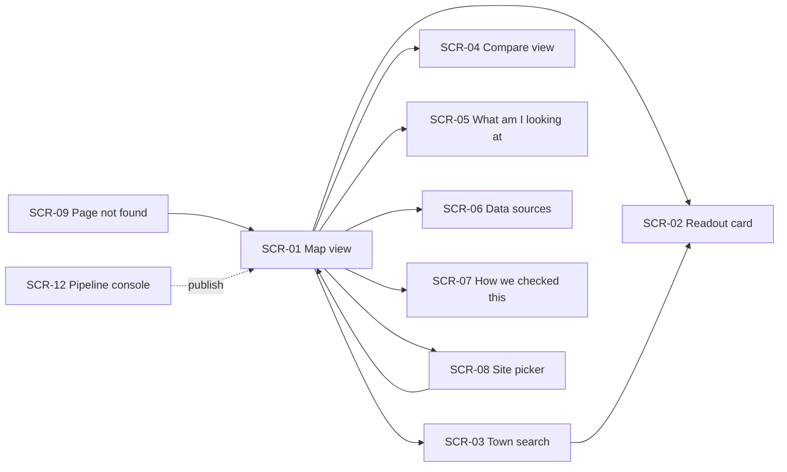
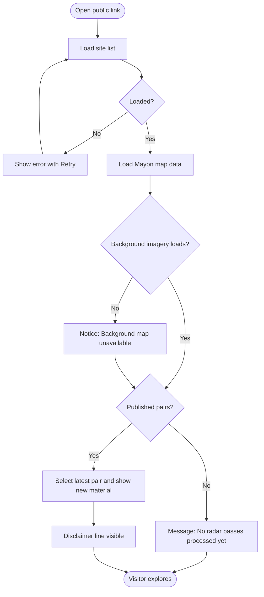
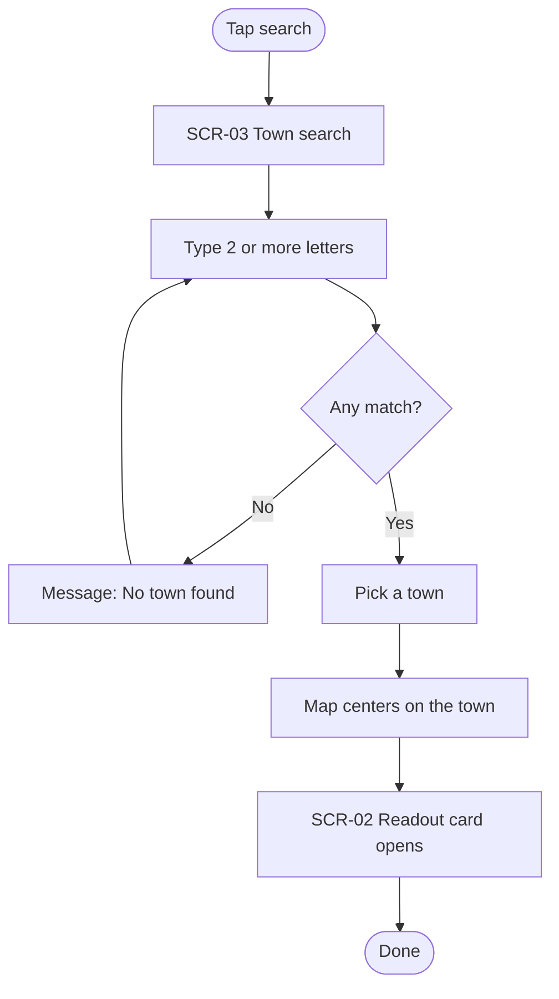
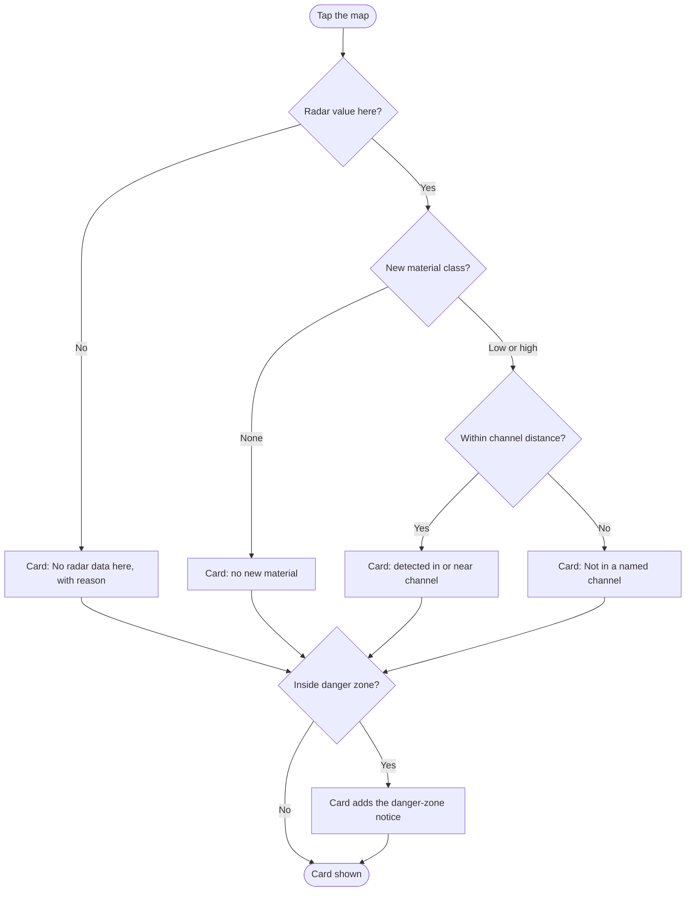
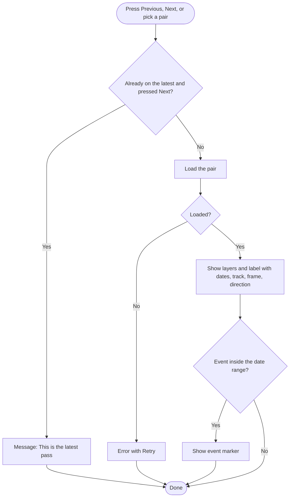
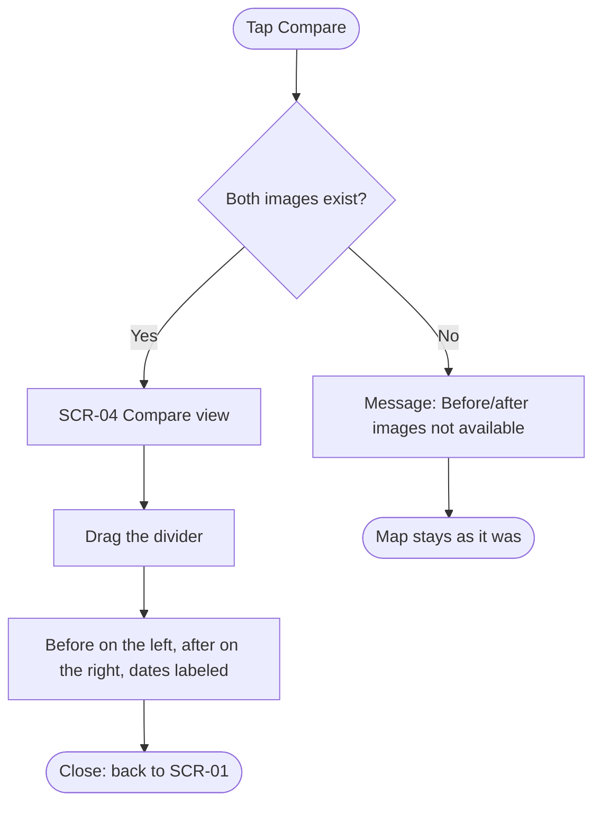
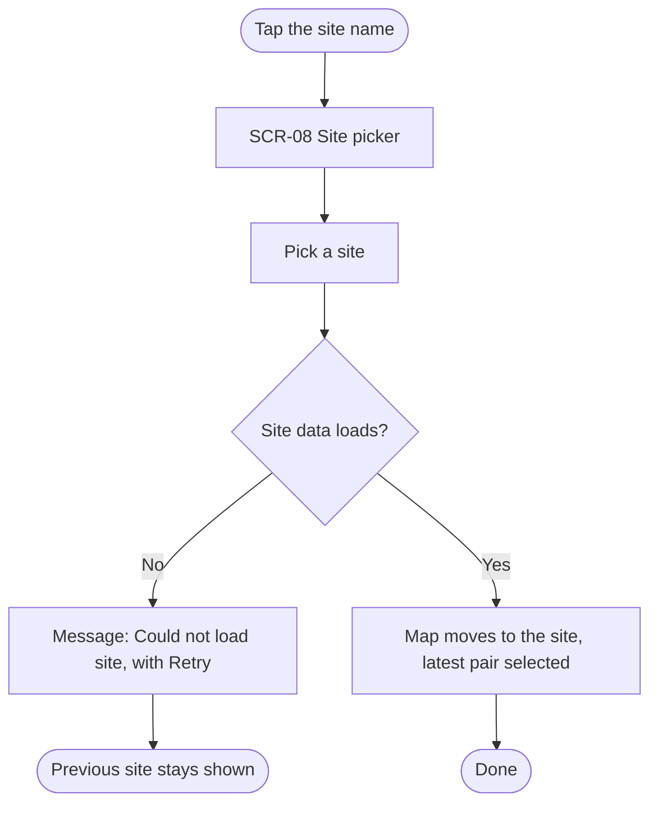
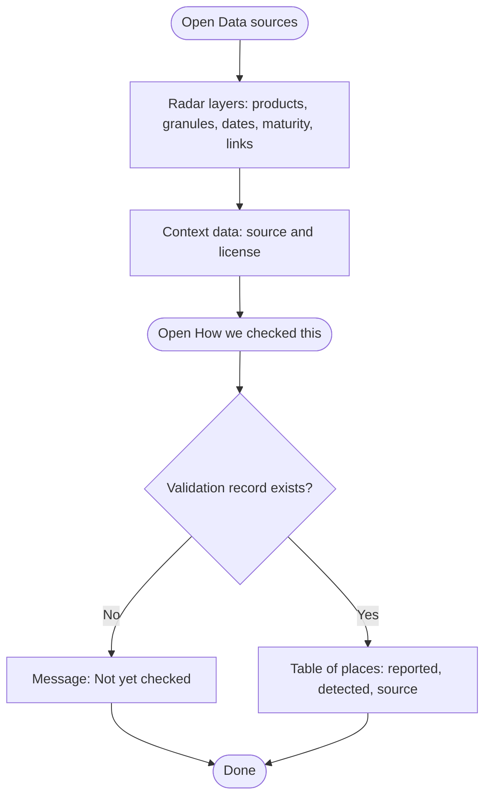
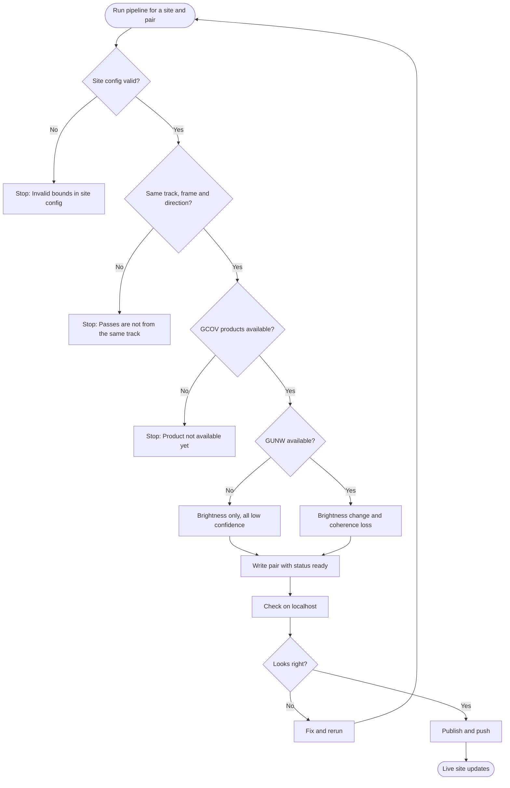

# User Flows and Screens: Mayon Radar Watch

| Version | Status | Last updated | Based on |
| --- | --- | --- | --- |
| 0.1 | Draft | 2026-10-31 | 01-prd.md v0.1 (Draft), 02-mvp-scope.md v0.1 (Draft) |

Layout approach, Suggestion: mobile-first. One full-screen map with a top bar (site name, search, help) and a bottom bar (timeline). Details open as a bottom sheet on phones and a side panel on desktops. Residents mainly use phones (brief §7), and the core journey happens on one map.

## 1. Screen Inventory

| SCR-ID | Screen | Purpose | Roles | US-IDs | MVP |
| --- | --- | --- | --- | --- | --- |
| SCR-01 | Map view | Main screen: map, layers, legend, timeline, disclaimer | Visitor | US-001, US-002, US-005, US-006, US-008, US-012, US-016, US-018, US-023; later US-010, US-011, US-022 | Yes |
| SCR-02 | Readout card | Plain-language facts for a tapped spot, town or channel | Visitor | US-003, US-004, US-023 | Yes |
| SCR-03 | Town search | Find a town by name | Visitor | US-003 | Yes |
| SCR-04 | Compare view | Swipe between the before and after radar images | Visitor | US-007 | Yes |
| SCR-05 | "What am I looking at?" panel | Explain radar, colors, confidence, limitations, official sources | Visitor | US-012 | Yes |
| SCR-06 | Data sources panel | Radar products and context data behind every layer | Visitor | US-013, US-023 | Yes |
| SCR-07 | "How we checked this" panel | Validation of a pair against an independent source | Visitor | US-017 | Yes |
| SCR-08 | Site picker | Switch between published sites | Visitor | US-014 | Yes |
| SCR-09 | Page not found | Recover from a wrong link | Visitor | US-016 | Yes |
| SCR-10 | Point history | Chart of a spot across every pair | Visitor | US-019 | No |
| SCR-11 | Language menu | Switch the interface language | Visitor | US-020 | No |
| SCR-12 | Pipeline console | Where the maintainer runs, checks and publishes pairs (notebook or command line, not a web page) | Maintainer | US-009, US-015; later US-021 | Yes |

## 2. Navigation Map

## 3. User Flows

### Flow 1: First visit (US-016, US-001, US-006, US-012)

The visitor lands on the newest Mayon pair; missing background imagery or missing pairs never block the map.

### Flow 2: Find my town (US-003)

Search only matches the site's town list; a miss never moves the map.

### Flow 3: Read a tapped spot (US-004, US-008, US-023)

Every tap produces a card; the danger-zone notice is added whatever the radar result.

### Flow 4: Step through passes (US-005)

The timeline only lists published pairs, newest last.

### Flow 5: Compare before and after (US-007)

### Flow 6: Switch site (US-014)

### Flow 7: Check sources and validation (US-013, US-017)

### Flow 8: Process and publish a pair (US-009, US-015)

Nothing is written when a check fails; only published pairs reach visitors (FR-059).

## 4. Screen Details

### SCR-01: Map view

**Purpose:** See the site, its layers and the selected pair; reach every other screen.
**Roles:** Visitor
**Stories:** US-001, US-002, US-005, US-006, US-008, US-012, US-016, US-018, US-023

**Elements**

| Element | Type | Behavior and validation |
| --- | --- | --- |
| Site name button | Button | Shows the current site's name; opens SCR-08 |
| Search button | Button | Opens SCR-03 |
| Help button | Button | Opens SCR-05 |
| Map | Map | Pan and zoom between the site's minimum and maximum zoom (US-002/AC-1, US-002/AC-2) |
| Background imagery | Map layer | On failure, shows "Background map unavailable" and keeps borders, coastline and the danger-zone ring (US-001/AC-2) |
| Town borders and names | Map layer | Always on (US-001/AC-1) |
| Danger-zone ring | Map layer | 6 km ring labeled "Permanent Danger Zone (6 km)" for Mayon (US-001/AC-1) |
| New-material layer | Map layer and toggle | On by default; classes by confidence (US-008/AC-1, US-008/AC-3) |
| Channels layer | Map layer and toggle | Named channel lines with names (US-023/AC-1) |
| Legend | Panel | Class names, confidence, units, total detected area in km² with 2 decimals, channel sources (US-008/AC-1, US-023/AC-3) |
| Summary line | Text | "No new material detected between <before date> and <after date>" when the area is 0 km² (US-008/AC-2) |
| Compare button | Button | Opens SCR-04 (US-007) |
| Timeline | Control | Previous and Next buttons, pair list, event markers, pair label (US-005/AC-1, US-005/AC-3) |
| Disclaimer line | Text | "This is not an official warning. Follow PHIVOLCS and your LGU." always visible while a radar layer is on (US-012/AC-2) |
| Footer links | Links | "Data sources" opens SCR-06; "How we checked this" opens SCR-07 |

**Actions**

| Action | Result | Goes to |
| --- | --- | --- |
| Tap the map | Readout for that spot | SCR-02 |
| Tap a channel line | Channel name and its towns | SCR-02 |
| Press Next on the latest pair | "This is the latest pass" | SCR-01 |
| Pick a pair | Layers and label update | SCR-01 |
| Tap Compare | Compare view opens | SCR-04 |
| Tap the site name | Site picker opens | SCR-08 |

**States**

| State | What the user sees |
| --- | --- |
| Empty | Base map, borders and danger-zone ring with "No radar passes processed yet for this site" (US-006/AC-2) |
| Loading | Base map with a "Loading radar data…" indicator over the map |
| Error | "Couldn't load <site name>. Try again." with a Retry button; the previous site stays if there was one (US-014/AC-2). If the site list itself fails on first visit, Suggestion: "Couldn't load the site list. Try again." with a Retry button |
| Success | Latest pair selected with its layers, legend, label and disclaimer (US-006/AC-1) |

### SCR-02: Readout card

**Purpose:** Read what the radar found at one spot, town or channel, in plain words.
**Roles:** Visitor
**Stories:** US-003, US-004, US-023

**Elements**

| Element | Type | Behavior and validation |
| --- | --- | --- |
| Place name | Text | Town name for a spot or town; channel name for a channel (US-004/AC-1, US-023/AC-1) |
| Distance to summit | Text | In km with 1 decimal (US-004/AC-1) |
| Danger-zone notice | Text | "Inside the Permanent Danger Zone. Entry is not allowed." when within the radius (US-004/AC-3) |
| New-material result | Text | None, low confidence or high confidence (US-004/AC-1) |
| No-data message | Text | "No radar data here" plus one reason: outside radar coverage, sea, or a slope the radar can't see (US-004/AC-2) |
| Channel line | Text | "New material detected in or near <channel name>" or "Not in a named channel" (US-023/AC-2) |
| Towns along the channel | List | Shown when a channel was tapped (US-023/AC-1) |
| Pair dates | Text | Before and after dates of the selected pair |
| Close | Button | Closes the card |

**Actions**

| Action | Result | Goes to |
| --- | --- | --- |
| Tap Close | Card closes | SCR-01 |
| Tap another spot | Card updates | SCR-02 |

**States**

| State | What the user sees |
| --- | --- |
| Empty | Not applicable: the card only opens after a tap, a search or a channel tap |
| Loading | "Reading radar values…" while the pair's values download |
| Error | "No radar data here" with its reason (US-004/AC-2). If the values file fails to download, Suggestion: "Couldn't load radar values. Try again." with a Retry button |
| Success | All fields filled for the spot, town or channel |

### SCR-03: Town search

**Purpose:** Jump to a town by name.
**Roles:** Visitor
**Stories:** US-003

**Elements**

| Element | Type | Behavior and validation |
| --- | --- | --- |
| Search field | Input | Suggestions start after 2 letters (US-003/AC-1) |
| Suggestion list | List | Matching town names from the site's town list |
| No-match message | Text | "No town found. Try another name or tap the map." (US-003/AC-2) |
| Close | Button | Returns to the map |

**Actions**

| Action | Result | Goes to |
| --- | --- | --- |
| Pick a suggestion | Map centers on the town and its card opens | SCR-02 |
| Submit a name with no match | No-match message; map doesn't move | SCR-03 |
| Tap Close | Search closes | SCR-01 |

**States**

| State | What the user sees |
| --- | --- |
| Empty | Hint "Type a town name" |
| Loading | "Loading towns…" if the town list hasn't arrived yet |
| Error | Suggestion: "Town list unavailable. Tap the map instead." |
| Success | Suggestion list with matching towns |

### SCR-04: Compare view

**Purpose:** See the before and after radar images side by side.
**Roles:** Visitor
**Stories:** US-007

**Elements**

| Element | Type | Behavior and validation |
| --- | --- | --- |
| Before image | Map layer | Left of the divider, labeled with its date (US-007/AC-1) |
| After image | Map layer | Right of the divider, labeled with its date (US-007/AC-1) |
| Divider | Draggable handle | Moves the split between the images |
| Close | Button | Returns to the map |

**Actions**

| Action | Result | Goes to |
| --- | --- | --- |
| Drag the divider | Split moves | SCR-04 |
| Tap Close | Compare view closes | SCR-01 |

**States**

| State | What the user sees |
| --- | --- |
| Empty | Not applicable: Compare opens only for a selected pair |
| Loading | "Loading radar images…" |
| Error | "Before/after images not available for this pair"; the map stays as it was (US-007/AC-2) |
| Success | Both images with dates and the divider |

### SCR-05: "What am I looking at?" panel

**Purpose:** Explain the map and point to official warnings.
**Roles:** Visitor
**Stories:** US-012

**Elements**

| Element | Type | Behavior and validation |
| --- | --- | --- |
| How radar sees | Text | Short explanation (US-012/AC-1) |
| Color meanings | List | Every layer's classes and colors (US-012/AC-1) |
| Confidence levels | List | None, low, high, and what each means (US-012/AC-1) |
| Limitations | List | At least 3 items (US-012/AC-1) |
| Official sources | Link | Link to PHIVOLCS (US-012/AC-1) |
| Close | Button | Returns to the map |

**Actions**

| Action | Result | Goes to |
| --- | --- | --- |
| Tap the PHIVOLCS link | Opens PHIVOLCS in a new tab | External |
| Tap Close | Panel closes | SCR-01 |

**States**

| State | What the user sees |
| --- | --- |
| Empty | Not applicable: fixed text shipped with the app |
| Loading | Not applicable: fixed text shipped with the app |
| Error | Not applicable: fixed text shipped with the app |
| Success | The full explanation |

### SCR-06: Data sources panel

**Purpose:** Show exactly which data made each layer.
**Roles:** Visitor
**Stories:** US-013, US-023

**Elements**

| Element | Type | Behavior and validation |
| --- | --- | --- |
| Radar layers list | List | Product type, granule IDs, acquisition dates, maturity, ASF link per layer (US-013/AC-1) |
| Context data list | List | Source and license for background map, borders, coastline and channels (US-013/AC-2, US-023/AC-3) |
| Close | Button | Returns to the map |

**Actions**

| Action | Result | Goes to |
| --- | --- | --- |
| Tap an ASF link | Opens the product on ASF in a new tab | External |
| Tap Close | Panel closes | SCR-01 |

**States**

| State | What the user sees |
| --- | --- |
| Empty | "Pick a radar pass to see its sources" when no pair is selected; context data still listed |
| Loading | "Loading sources…" |
| Error | Suggestion: "Couldn't load sources. Try again." with a Retry button |
| Success | Both lists filled |

### SCR-07: "How we checked this" panel

**Purpose:** Compare a pair's result with an independent source.
**Roles:** Visitor
**Stories:** US-017

**Elements**

| Element | Type | Behavior and validation |
| --- | --- | --- |
| Source line | Text | Source name, date and link (US-017/AC-1) |
| Validation table | Table | Place, reported by the source (yes or no), detected by the app (yes, no, not visible to radar), note (US-017/AC-1) |
| Close | Button | Returns to the map |

**Actions**

| Action | Result | Goes to |
| --- | --- | --- |
| Tap the source link | Opens the source in a new tab | External |
| Tap Close | Panel closes | SCR-01 |

**States**

| State | What the user sees |
| --- | --- |
| Empty | "Not yet checked against an independent source" (US-017/AC-2) |
| Loading | "Loading check…" |
| Error | Suggestion: "Couldn't load this check. Try again." with a Retry button |
| Success | Source line and table |

### SCR-08: Site picker

**Purpose:** Switch sites.
**Roles:** Visitor
**Stories:** US-014

**Elements**

| Element | Type | Behavior and validation |
| --- | --- | --- |
| Site list | List | Every published site with its name and country (US-014/AC-1) |
| Close | Button | Returns to the map |

**Actions**

| Action | Result | Goes to |
| --- | --- | --- |
| Pick a site | Map moves to the site with its latest pair | SCR-01 |
| Tap Close | Picker closes | SCR-01 |

**States**

| State | What the user sees |
| --- | --- |
| Empty | Suggestion: "No sites available yet" |
| Loading | "Loading sites…" |
| Error | Picking a site that fails: "Couldn't load <site name>. Try again." with a Retry button; previous site stays (US-014/AC-2). Site list itself fails, Suggestion: "Couldn't load the site list. Try again." with a Retry button |
| Success | The site list |

### SCR-09: Page not found

**Purpose:** Recover from a wrong link.
**Roles:** Visitor
**Stories:** US-016

**Elements**

| Element | Type | Behavior and validation |
| --- | --- | --- |
| Message | Text | "Page not found" (US-016/AC-2) |
| Back to the map | Link | Opens SCR-01 (US-016/AC-2) |

**Actions**

| Action | Result | Goes to |
| --- | --- | --- |
| Tap Back to the map | Map opens | SCR-01 |

**States**

| State | What the user sees |
| --- | --- |
| Empty | Not applicable: fixed page |
| Loading | Not applicable: fixed page |
| Error | Not applicable: this page is the error state |
| Success | Message and link |

### SCR-12: Pipeline console

**Purpose:** Process, check and publish pairs and sites. This is a notebook or command line, not a web page.
**Roles:** Maintainer
**Stories:** US-009, US-015

**Elements**

| Element | Type | Behavior and validation |
| --- | --- | --- |
| Site config file | File | One file per site; bounds must satisfy west < east and south < north (US-015/AC-2) |
| Run command or cell | Command | Takes a site and the two passes of a pair |
| Progress log | Text output | One line per step |
| Error output | Text output | "Invalid bounds in site config: <file>", "Passes are not from the same track, frame and direction", "Product not available yet: <granule_id>" (US-015/AC-2, US-009/AC-2, US-009/AC-3) |
| Summary output | Text output | Pair ID, status "ready", granule IDs, detected areas in km² (US-009/AC-1) |
| Publish command or cell | Command | Marks a ready pair "published" so it reaches visitors (FR-059) |

**Actions**

| Action | Result | Goes to |
| --- | --- | --- |
| Run a pair | Pair written with status "ready", or an error and no files | SCR-12 |
| Publish a pair | Pair status becomes "published" and appears on the live site after a push | SCR-01 |

**States**

| State | What the user sees |
| --- | --- |
| Empty | Suggestion: "No passes found for this site and track" when a search returns nothing |
| Loading | Progress lines for search, download, processing and export |
| Error | One of the three error messages above; no files written |
| Success | The summary output |

## 5. Edge Cases

| Situation | Expected behavior | Screens |
| --- | --- | --- |
| No internet connection | Data requests fail; the error state with a Retry button shows; nothing already on screen disappears | SCR-01, SCR-06, SCR-07, SCR-08 |
| Session expired | Not applicable: there is no login | — |
| No permission | Not applicable: all visitor content is public and read-only | — |
| Invalid input | Search with no match shows "No town found. Try another name or tap the map." (US-003/AC-2) | SCR-03 |
| Tap where there is no radar value | "No radar data here" with its reason (US-004/AC-2) | SCR-02 |
| Next pressed on the latest pair | "This is the latest pass" (US-005/AC-2) | SCR-01 |
| One pair's files fail to load | Suggestion: "Couldn't load this pass. Try again." with Retry; the previous pair stays shown | SCR-01 |
| The channel file fails to load | Suggestion: the channel layer is hidden and the legend says "Channels unavailable"; the readout leaves out the channel line | SCR-01, SCR-02 |
| The events file fails to load | Suggestion: the timeline shows no event markers; everything else works | SCR-01 |
| New data published while the page is open | The page keeps the data it loaded; a reload shows the new pairs | SCR-01 |
| Unknown path | "Page not found" with a link to the map (US-016/AC-2) | SCR-09 |

## 6. Assumptions

- The core journey happens on one map screen; panels open over it instead of on separate pages.
- The maintainer's console is a Colab notebook or a command line; it has no web interface.
- Dates on screen use the site's local time zone (FR-014).

## 7. Open Questions

| # | Question | Affects |
| --- | --- | --- |
| 1 | Mobile-first with a single map screen and bottom sheets: accept or change? | §1 layout approach |
| 2 | Any apps or websites whose layout you like? | SCR-01 |
| 3 | Accept the Suggestion error and empty messages not covered by acceptance criteria (SCR-03, SCR-06, SCR-07, SCR-08, SCR-12, §5)? | SCR-03, SCR-06, SCR-07, SCR-08, SCR-12 |

## 8. Conflicts with Earlier Documents

None.

## 9. Revision History

| Version | Date | Changes |
| --- | --- | --- |
| 0.1 | 2026-10-31 | First draft |
