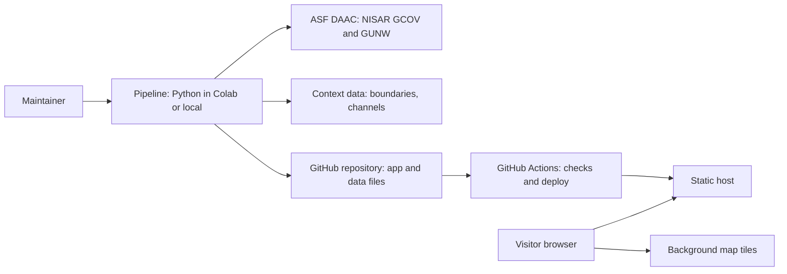
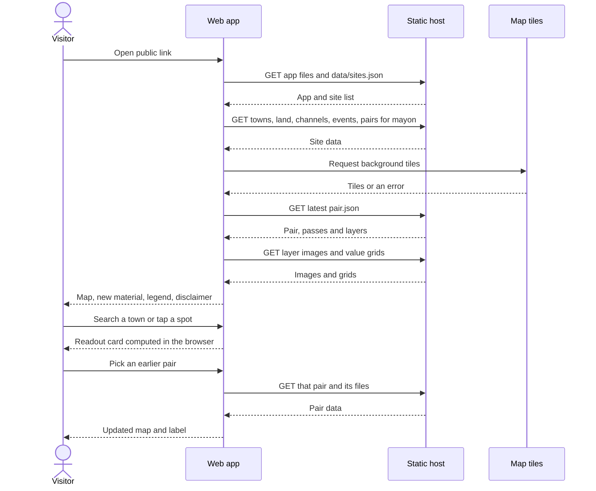
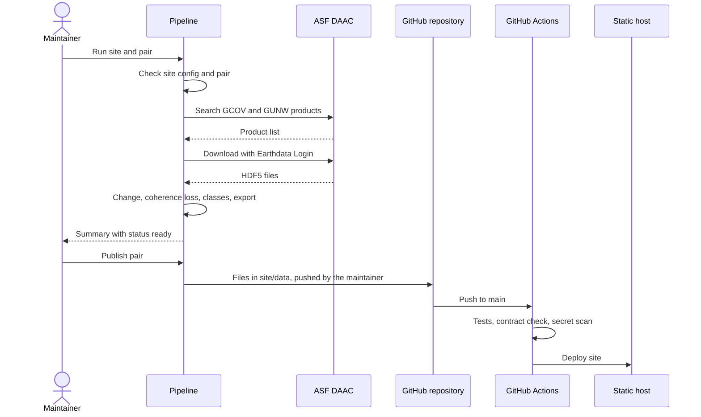

# Technical Design: Mayon Radar Watch

| Version | Status | Last updated | Based on |
| --- | --- | --- | --- |
| 0.2 | Draft | 2026-11-01 | 00 v0.4 (Draft), 01 v0.2 (Draft), 02 v0.2 (Draft), 03 v0.2 (Draft) |

## 1. Architecture Overview

The system has two halves with no server between them. A Python processing pipeline, run by the maintainer in Google Colab or locally, downloads NISAR products from ASF, computes the layers, and writes static data files into the Git repository. A static web app (HTML, CSS, JavaScript and Leaflet) is deployed from that repository to a static host and reads those files directly in the visitor's browser; every readout is computed in the browser.



## 2. Tech Stack

| Layer | Choice | Version | Reason |
| --- | --- | --- | --- |
| Frontend | Leaflet for the map (stated). Suggestion: plain HTML, CSS and JavaScript modules, no framework | Leaflet 1.9.4 (stated) | Leaflet is the stated preference; the existing `template.html` already uses plain JavaScript; fewest tools for a beginner builder (brief §7) |
| Backend | Not applicable: no server | — | All processing happens offline (ADR-001, ADR-002) |
| Processing pipeline | Python with `asf_search`, `earthaccess`, `h5py`, `rasterio` (stated), plus `numpy`, `scipy`, `pyproj`, `shapely`, `Pillow`, `matplotlib` (already used in the project's `make_data.py` and `common.py`) | Colab's current Python 3 (verify); latest library releases (verify) | Matches the stated tools and the code that already produced the first Mayon results |
| Database | Not applicable: static JSON, GeoJSON, image and binary files (see 05) | — | Small, read-only, public data (ADR-003) |
| Authentication | None for visitors. Maintainer: NASA Earthdata Login via `earthaccess` and `~/.netrc` (stated) | — | Visitors only read public data (PRD §4); Earthdata Login is required to download NISAR data |
| File storage | Published outputs in the repository under `site/data/`; downloaded HDF5 files in a local `raw/` folder or Google Drive, never committed | — | Outputs are small; raw products are large and can be downloaded again from ASF |
| Hosting | Suggestion: GitHub Pages, deployed by GitHub Actions | — | Free for public repositories (verify); the code must be public anyway (F-11) (ADR-005) |
| Email / notifications | Not applicable in the MVP | — | Automatic updates (F-17) are deferred to v1.2 |
| Testing | Suggestion: `pytest` for the pipeline, a Python data-contract check for published files, manual browser checks | `pytest` latest (verify) | Tests the parts most likely to be wrong (math and file format) with the least setup (see 08) |
| Background map tiles | The site's own relief tiles, and EOxCloudless for Satellite | — | ADR-012, ADR-013 |

**Stack decision gate.** Two layers are still undecided. Pick one option for each:

Frontend approach:

| Option | Pros | Cons | Cost per month (verify) | Fit for my constraints |
| --- | --- | --- | --- | --- |
| Suggestion: plain JavaScript modules + Leaflet | No build step; the existing app already works this way; easy to debug in the browser | More manual code for UI state | PHP 0 | Best for a beginner with 2 weeks |
| React or Svelte with Vite + Leaflet | Cleaner UI state for many panels | New tools to learn; a build step to debug | PHP 0 | Weaker: adds learning time before the hackathon |

Hosting:

| Option | Pros | Cons | Cost per month (verify) | Fit for my constraints |
| --- | --- | --- | --- | --- |
| Suggestion: GitHub Pages via GitHub Actions | Code, data and site in one place; one account | Site size and bandwidth limits (verify); no custom headers | PHP 0 for public repositories (verify) | Best: the code must be public on GitHub anyway |
| Netlify | Deploy previews for each branch; custom headers | A second account; build-minute limits (verify) | PHP 0 on the free tier (verify) | Good |
| Vercel | Deploy previews; fast global hosting | A second account; aimed at JavaScript frameworks | PHP 0 on the free tier (verify) | Good |

## 3. Modules

| Module | Responsibility | F-IDs |
| --- | --- | --- |
| `config` | Read and check one site config file per site (bounds, center, zooms, summit, danger zone, time zone) | F-10 |
| `search` | Find NISAR GCOV and GUNW products for a site, track, frame and orbit direction on ASF | F-03, F-05 |
| `pairs` | Build consecutive same-track pairs; refuse mixed tracks; stop on missing GCOV products | F-03, F-05 |
| `download` | Download or stream products, cropped to the site bounds, cached in `raw/` | F-05 |
| `gcov` | Read HH backscatter, crop, speckle-filter, convert to dB, compute brightness change, apply masks | F-04, F-05 |
| `coherence` | Read GUNW coherence for the current and previous pair; compute coherence loss | F-05 |
| `classify` | Apply the final rule and thresholds; produce none, low and high confidence classes and areas in km² | F-05 |
| `context` | Prepare towns, land, coastline and events for a site, and the shared sources file | F-01, F-02, F-03 |
| `channel_areas` | Write the confirmed channels with their towns, strips and any part past the reach distance; compute the flagged area per channel per pair | F-19, F-20 |
| `export` | Reproject to EPSG:4326, colorize, write images, value grids and JSON records to `pipeline/out/` | F-03, F-04, F-05, F-09 |
| `publish` | Copy a checked pair from `pipeline/out/` to `site/data/`, set status "published", rebuild the pair list | F-03, F-11 |
| `validation` | Turn a hand-filled validation sheet into a validation record | F-12 |
| `contract_check` | Check every published file against 05 before deploy | F-09, F-11 |
| Web: `data.js` | Fetch data files; turn failures into NOT_FOUND, NETWORK_ERROR or INVALID_DATA | F-01, F-03, F-10 |
| Web: `map.js` | Map, zoom limits, background tiles with fallback, borders, coastline, danger-zone ring | F-01 |
| Web: `timeline.js` | Pair list, latest-pair default, Previous and Next, event markers, unequal-gap note | F-03, F-20 |
| Web: `layers.js` | New-material and channel layers, legend, summary line | F-05, F-19 |
| Web: `readout.js` | Decode value grids and build the readout card for a tap, town or channel | F-02, F-19 |
| Web: `channels.js` | Channel list, channel view, bars, strip on the map | F-20 |
| Web: `search.js` | Town suggestions and no-match message | F-02 |
| Web: `compare.js` | Before/after divider | F-04 |
| Web: `panels.js` | "What am I looking at?", Data sources, "How we checked this" with "Tested in Panama" | F-08, F-09, F-10, F-12 |
| Web: `strings.js` | Every piece of interface text in one place, for review against FR-038 | F-08, F-13 |

## 4. Authentication and Authorization

| Item | Design |
| --- | --- |
| Login method | Visitors: none. Maintainer: NASA Earthdata Login (for downloads) and a GitHub account (for publishing). |
| Session or token | Visitors: none. Maintainer: Earthdata credentials saved in `~/.netrc` by `earthaccess.login(persist=True)`; token lifetimes are managed by NASA (verify). |
| Password rules and reset | Not applicable: no accounts in this system; Earthdata and GitHub manage their own passwords. |
| Role enforcement | Visitor is read-only by design: the static host only serves files. Maintainer rights come from write access to the GitHub repository; the site deploys only from the `main` branch through GitHub Actions. |
| NFRs covered | NFR-002, NFR-007 |

## 5. Core Flow Sequence

Visitor journey (02 §5):



Maintainer processing (US-009, US-015):



## 6. Third-Party Services

| Service | Used for | Free-tier limits (verify) | Fallback if it fails |
| --- | --- | --- | --- |
| ASF DAAC (Vertex, ASF Search API) | Finding and downloading NISAR products | Free with an Earthdata account (verify); search results can be incomplete at times (seen in the progress notes) | Re-run the search later; use cached products in `raw/` |
| NASA Earthdata Login | Download authentication | Free account (verify) | None: downloads wait until login works |
| EOxCloudless tiles | Satellite background | Free for non-commercial use with attribution; no published rate limit found; a 1920 px view took 102 s in testing, so a low-detail layer and a loading count come first | The relief stays under it; borders, coastline and danger-zone ring drawn from the app's own data (FR-003, FR-005) |
| GitHub (repository and Actions) | Public code, CI checks, deploys | Actions minutes for public repositories (verify) | Build and check locally; push again later |
| GitHub Pages | Public static hosting | Site size about 1 GB and soft bandwidth about 100 GB per month (verify) | Netlify or Vercel serving the same `site/` folder |
| Google Colab | Running the pipeline | Session time and memory limits (verify) | Run locally on Windows with the same requirements |
| Google Drive | Caching downloads and outputs between Colab sessions | 15 GB free storage (verify) | Local `raw/` folder |

Leaflet is copied into `site/vendor/` instead of loaded from a CDN, so the app has one less outside dependency (Suggestion).

## 7. Environments and Deployment

| Environment | Host | Purpose | Deploys from |
| --- | --- | --- | --- |
| Local | Developer machine: `python -m http.server` in `site/` | Development and checking a pair before publishing | — |
| Staging | Not used in the MVP (02 §7 shortcut) | — | — |
| Production | GitHub Pages (Suggestion) | Live visitors and judges | `main` branch via GitHub Actions |

**CI/CD:** On every push to any branch and on every pull request, a GitHub Actions workflow runs the secret scan, `pytest` (no downloads), the browser tests in Chromium, and the data-contract check on `site/data/`. On a push to `main`, the same checks run and, if all pass, the `site/` folder deploys to GitHub Pages. Any failure stops the deploy. A separate workflow scans the whole Git history weekly and on demand.
**Secrets:** Earthdata credentials live only in the maintainer's `~/.netrc`, or are typed at the Colab login prompt. `.gitignore` excludes `.netrc`, `raw/`, `*.h5` and `pipeline/out/`. Automatic updates (F-17, v1.2) would use GitHub repository secrets (brief §8).

## 8. Security

| Measure | How | NFR-IDs |
| --- | --- | --- |
| Input validation | The only visitor input is the town search: it is matched against the site's town list, and all text is inserted with `textContent`, never as HTML. Published data files must pass the contract check before deploy. | NFR-002 |
| Data encryption | In transit: HTTPS only, enforced by the host (verify the GitHub Pages "Enforce HTTPS" setting). At rest: not applicable, because all published data is public and no personal data exists. | NFR-002, NFR-007 |
| Rate limiting | Not applicable to our code: there is no API. The static host handles traffic limits (verify). | NFR-006 |
| Backups | Git history backs up code and published data. Raw products can be downloaded again from ASF. Suggestion: copy `raw/` to Google Drive during the hackathon. | NFR-003 |
| Secret scanning | Suggestion: a secret-scanning step in CI, plus GitHub's own secret scanning (verify) | NFR-002 |
| Content Security Policy | Suggestion: a `<meta>` CSP allowing scripts only from the site itself and images only from the site and the tile host | NFR-002 |
| No tracking | No analytics, no cookies, no third-party scripts besides the copied Leaflet | NFR-007 |

## 9. Error Handling, Logging, and Monitoring

| Item | Design | NFR-IDs |
| --- | --- | --- |
| User-facing errors | Messages come from the PRD and 03. `data.js` turns every failed fetch into NOT_FOUND, NETWORK_ERROR or INVALID_DATA and the screen shows its error state with Retry. | NFR-004 |
| Logging | Browser: console only, nothing sent anywhere. Pipeline: one log file per run in `pipeline/logs/` (not committed); every pair record stores the pipeline version and timestamps. | NFR-007, NFR-008 |
| Monitoring and alerts | MVP: the maintainer opens the public link daily during judging; GitHub Actions emails on failed runs (verify). | NFR-003 |
| Performance budget | Overlays saved as WebP or PNG at a size that keeps the first view within the NFR-001 target; value grids load only for the selected pair; measured with Chrome DevTools throttling. | NFR-001 |
| Browser support | Only JavaScript and CSS features supported by the NFR-005 browsers; checked on real phones. | NFR-005 |
| Accessibility | Contrast checks, 44 × 44 px tap targets, a text label for every color class. | NFR-004 |
| Scalability | Static files served by the host's content network; no server to overload. | NFR-006 |
| Data quality | The contract check fails the deploy if any layer lacks dates, units, maturity or a confidence legend. | NFR-008 |
| Data freshness | After each expected pass, the maintainer searches ASF 36–72 h later and processes new pairs. | NFR-009 |

## 10. Folder Structure

```text
mayon-radar-watch/
├── docs/                      # planning documents (this kit)
├── plans/                     # the owner's run plans, kept as written
├── pipeline/
│   ├── mrw/                   # Python package: config, search, pairs, download, gcov, coherence, classify, context, channel_areas, export, publish, validation, contract_check
│   ├── sites/                 # one config file per site, e.g. mayon.json
│   ├── context/               # source files for boundaries, channels, events, validation sheets
│   ├── notebooks/             # Colab notebooks, incl. nisar_albay_starter.ipynb
│   ├── tests/                 # pytest tests
│   ├── out/                   # processed pairs before publishing (not committed)
│   ├── logs/                  # run logs (not committed)
│   └── requirements.txt
├── raw/                       # downloaded HDF5 products (not committed)
├── site/                      # everything deployed to the public site
│   ├── index.html
│   ├── 404.html
│   ├── css/
│   ├── js/                    # data, map, timeline, layers, readout, channels, search, compare, panels, strings
│   ├── vendor/leaflet-1.9.4/
│   └── data/                  # published data files (see 05 and 06)
├── .github/workflows/         # CI checks and deploy
├── .gitignore
├── CHANGELOG.md
└── README.md
```

## 11. Architecture Decision Records

### ADR-001: No backend server

- **Context:** Visitors only read public results; there are no accounts or uploads (PRD §4). The builder is a beginner with about 2 weeks (brief §7).
- **Decision:** Serve the app and all data as static files. No server code runs at request time.
- **Alternatives considered:** A Python web server (for example Flask) computing layers on request: too slow for multi-gigabyte inputs and adds hosting cost and failure points.
- **Consequences:** New results appear only when the maintainer publishes. Anything dynamic happens in the browser.

### ADR-002: Process offline in Python, show precomputed results

- **Context:** NISAR products are multi-gigabyte HDF5 files that need Earthdata Login (brief §2, §8).
- **Decision:** The maintainer runs the Python pipeline in Colab or locally; it writes small, ready-to-show files.
- **Alternatives considered:** Processing in the browser (impossible at this size); cloud functions (cost, complexity).
- **Consequences:** Processing depends on the maintainer's time and internet; F-17 can automate it later.

### ADR-003: Static data files instead of a database

- **Context:** Data is small, public, read-only for visitors and changes only when a pair is published.
- **Decision:** Store data as JSON, GeoJSON, images and binary value grids under `site/data/`, with the structure in 05.
- **Alternatives considered:** A hosted database such as PostgreSQL with PostGIS: needs a server or a paid service and adds accounts and secrets.
- **Consequences:** No queries at runtime, so the app loads data by file path; data must be validated before deploy (contract check).

### ADR-004: Leaflet 1.9.4 with plain JavaScript

- **Context:** Leaflet 1.9.4 is the stated map library; the builder is a beginner.
- **Decision:** Suggestion: plain JavaScript modules with no framework or build step.
- **Alternatives considered:** React or Svelte with Vite (see §2 gate).
- **Consequences:** UI state is handled by hand in a few small modules; no build step to debug.

### ADR-005: Host on GitHub Pages via GitHub Actions

- **Context:** The code must be public (F-11); the budget is not stated (brief Open Question 6).
- **Decision:** Suggestion: deploy `site/` to GitHub Pages with a GitHub Actions workflow.
- **Alternatives considered:** Netlify and Vercel (see §2 gate).
- **Consequences:** Size and bandwidth limits apply (verify); no custom HTTP headers, so the CSP is a `<meta>` tag.

### ADR-006: Detect new material by brightness change; coherence loss raises confidence

- **Context:** Fresh deposits change radar brightness and destroy coherence; rain-soaked soil also changes brightness (brief §10, PRD FR-021 to FR-023).
- **Decision (final rule, gate 2, locked 2026-11-01):** A pixel is flagged by its brightness change alone (GCOV HH, dB). Coherence loss only raises a flagged pixel to high confidence and never adds area. The thresholds are final, set on 2026-11-01 before the post-eruption passes were opened; their values live in the site config. Coherence loss = coherence of the previous pair on the same track minus coherence of the current pair, both from GUNW `coherenceMagnitude`.
- **Alternatives considered:** Flagging on either signal (the first rule: coherence loss alone added area); coherence from GSLC at full resolution (more accurate, but more processing: later).
- **Consequences:** The first pair on a track has no coherence baseline, so it is low confidence at most, and so is any pair whose baseline spans a different number of days (FR-022). The owner lifted the blind cutoff (`BLIND_CUTOFF` in `pipeline/mrw/search.py`) to open the Oct 31 passes only; NISAR products acquired on or after 2026-11-01 (UTC) stay closed unless the owner moves it again. Each site can set a reach distance from the summit in its config (`filters.max_distance_km`). Nothing is flagged beyond it, and `sites.json` carries it to the browser (FR-060). GUNW is posted at about 80 m versus 10–20 m for GCOV (progress notes), so coherence is upsampled and high-confidence edges are blocky at about 80 m. GUNW products are assumed to exist for consecutive 12-day pairs (verify).

### ADR-007: Web rasters as reprojected images plus value grids

- **Context:** Small site extents (about 25 km across for Mayon); the existing app already displays overlays this way.
- **Decision:** For each layer, write one EPSG:4326 PNG or WebP overlay for display and one binary value grid for readouts, both covering the same bounds.
- **Alternatives considered:** Map tile pyramids (many files, more tools); Cloud-Optimized GeoTIFFs read in the browser (extra libraries).
- **Consequences:** Overlays are fixed resolution; zooming far in shows pixels. Fine for site-sized areas.

### ADR-008: Channels from the PHIVOLCS-named list; no flow routing

- **Context:** The brief puts computing flow paths from elevation data out of scope.
- **Decision:** Keep a fixed channel file: names from PHIVOLCS bulletins, lines from OpenStreetMap that the owner confirmed in Google Earth Pro, each linked to the towns it passes through.
- **Alternatives considered:** Flow routing from a DEM (out of scope; new skill).
- **Consequences:** The channel file must be checked by hand. "In or near a channel" means inside its strip (ADR-011). OpenStreetMap's license (ODbL) means crediting it on the map and keeping the channel files public under the same license.

### ADR-009: Keep unpublished pairs out of the public folder

- **Context:** Only published pairs may reach visitors (FR-059).
- **Decision:** The pipeline writes to `pipeline/out/` (not committed); the publish step copies a checked pair into `site/data/`.
- **Alternatives considered:** Writing straight into `site/data/` with a status flag: unpublished pairs would still be reachable by URL.
- **Consequences:** One extra step per pair; nothing half-finished ever deploys. The check on `pipeline/out/` reads only the pair folders under `sites/<site>/pairs/`, so screenshots, reports and scratch folders there can't block publishing.

### ADR-010: Background tiles with a self-drawn fallback

- **Context:** Tile services can block apps or require keys (progress notes: OpenStreetMap blocked, CartoDB needs a key).
- **Decision:** Use Esri tiles for the background; always draw borders, coastline and the danger-zone ring from the app's own data.
- **Alternatives considered:** No background tiles at all (less context for visitors).
- **Consequences:** The map stays usable when tiles fail (FR-005); tile terms and attribution must be checked (verify).

### ADR-011: Compute channel strips in the pipeline, with the width in the site config

- **Context:** The channel timeline (F-20) needs the area flagged along each channel for every pair. A value grid is over a megabyte per pair, so reading every pair in the browser would break the NFR-001 target. Area must also match the final rule exactly.
- **Decision:** The pipeline buffers each confirmed channel line into a strip of the width set in the site config (`channel_strip_half_width_m`, measured on each side of the line), measures the flagged area inside it in a metric projection, and publishes the results. The browser only draws them.
- **Alternatives considered:** Computing in the browser from each pair's grid (many downloads, and results could differ from the pipeline's); flow routing from elevation data (out of scope, ADR-008).
- **Consequences:** A new width or a newly confirmed channel means rerunning this step for all pairs. It needs no radar download, because it reads the published grids. Strips stop at the reach distance (FR-060), so the area of a long channel covers only its upper part, and what lies past it is drawn as "Not checked" (FR-071).
### ADR-012: Field map relief as static tiles, and radar marks drawn over the image

- **Context:** The owner chose the Field map design. Its relief has to fill the view without a plain band, and flagged cells smaller than a screen pixel have to stay visible on it. No published data may change.
- **Decision:** `pipeline/mrw/relief.py` downloads whole Copernicus DEM GLO-30 tiles into `raw/`, stopping before it starts if they total 300 MB or more, and logging the size. It renders WebP map tiles into `site/data/sites/{site_id}/relief/`, one set per zoom. The map stays inside the tiles' bounds, and its minimum zoom rises on a very wide screen. In the browser, `site/js/marks.js` reads the pair's existing image and draws each flagged cell on a canvas above it, at no less than a minimum size, with a darker edge.
- **Alternatives considered:** One large relief image (a heavy decode on a phone, and its contours would blur when zoomed); changing the published image (would change data, and it would be stuck at one size); a CSS shadow on the image (gives an edge, but cells under a pixel still vanish).
- **Consequences:** The relief adds static files and needs no third-party request. A small mark looks larger than the cell it stands for, so the legend says so. The owner approved Panama's relief on 2026-11-02.

### ADR-013: EOxCloudless for the Satellite background, replacing Esri

- **Context:** The owner asked for a Relief or Satellite choice, and for the imagery's terms to be checked first. Esri's "Frequently asked questions about items owned by Esri in ArcGIS Online" (April 21, 2025) says to use its content with Esri software, and that without Esri software an ArcGIS Online subscription must be bought. This app uses Leaflet and has no subscription. So this supersedes ADR-010's choice of Esri tiles.
- **Decision:** Use EOxCloudless (Sentinel-2 cloudless) 2024 from EOX's tile service, under CC BY-NC-SA 4.0 for non-commercial use, with the credit EOX asks for in the map while Satellite is on. The tiles are loaded from EOX and not stored here. The relief stays on under it, as the placeholder and the fallback.
- **Alternatives considered:** Esri with a subscription (a cost, and against the owner's rule); no imagery (the owner asked for it).
- **Consequences:** Imagery comes from 10 m data, so it's softer than Esri's at high zoom. Commercial use would need a paid EOX license. EOX's license page doesn't address calling its hosted tiles directly (open question for the owner in `NIGHT_REPORT.md`). `main` still loads Esri until `night-1` is merged.

### ADR-014: A written rule for holding a pair, set before any post-eruption data

- **Context:** The first passes after the eruption could look very different from the quiet ones. Deciding what counts as a bad pair after seeing them would invite choosing the answer. The owner set this rule on 2026-11-03, before any post-eruption product was opened.
- **Decision:** Hold a pair (don't publish it) automatically if any of these is true:
  - (a) a product isn't PROVISIONAL or better;
  - (d) large no-data gaps cover the volcano;
  - (e) the map shows stripe or edge patterns.

  Two far-field checks say "look closer", and neither holds a pair by itself:
  - (b) the median coherence change of land far from the summit, where an eruption shouldn't reach, falls outside the range of the same measure on the published pairs that used coherence;
  - (c) the flagged area far from the summit is above the highest of the published pairs with the usual gap, leaving out the pair with a longer gap.

  To look closer, compare the share of the flagged change near the volcano and far from it with the quiet pairs. If the change is concentrated near the volcano and its channels, publish. If it's spread evenly across the whole scene, hold.

  A large area alone is not a reason to hold. When both tracks (104 and 111) have a pair, report how much they agree next to the quiet pairs' agreement: it supports a decision and never blocks one. If only one track is ready, publish it with a "single track" note.
- **Alternatives considered:** A limit on total area, which would hold back exactly the result a real eruption should produce. Checking coherence across the whole reach, and holding automatically on it, which could hold a real eruption because of the eruption itself.
- **Consequences:** The reference numbers are fixed in `pipeline/reports/hold-check-baseline.json`, and the distances and the steps are in `pipeline/RUNBOOK-eruption.md`. Reasons (d) and (e) and the "look closer" judgement need a person to look at the map. No threshold values are written in these docs.

## 12. Assumptions

- The maintainer has write access to one public GitHub repository.
- GUNW products exist for consecutive same-track pairs (verify).
- Each site's published data stays well under the host's size limit (verify).

## 13. Open Questions

| # | Question | Affects |
| --- | --- | --- |
| 1 | Frontend: plain JavaScript (Suggestion), or a framework? | §2, ADR-004 |
| 2 | Hosting: GitHub Pages (Suggestion), Netlify or Vercel? | §2, §7, ADR-005 |
| 3 | Closed on 2026-11-01: OpenStreetMap, with the lines the owner confirmed. | ADR-008, F-19 |
| 4 | Answered on 2026-11-02: Esri's terms summary requires Esri software or an ArcGIS Online subscription, which this app doesn't have, so EOxCloudless replaces it (ADR-013) | ADR-010, ADR-013, F-01 |
| 5 | Is GUNW coherence at about 80 m fine enough, or should coherence come from GSLC later? | ADR-006 |

## 14. Conflicts with Earlier Documents

None. The conflict raised in 01-prd.md §13 (brief F-05 wording) closed with the final rule on 2026-11-01.

## 15. Revision History

| Version | Date | Changes |
| --- | --- | --- |
| 0.1 | 2026-10-31 | First draft |
| 0.2 | 2026-11-01 | CI text updated. ADR-006 now states the final rule, the reach distance and the lifted blind cutoff. Added ADR-011 and the `channel_areas` and `channels.js` modules. `channel_areas` also writes the channels file. |
