# Database Design: Mayon Radar Watch

| Version | Status | Last updated | Based on |
| --- | --- | --- | --- |
| 0.2 | Draft | 2026-11-01 | 01 v0.2 (Draft), 02 v0.2 (Draft), 04 v0.2 (Draft) |

**Database:** None. Per 04 (ADR-003), data is stored as static files under `site/data/`: JSON (UTF-8), GeoJSON (RFC 7946, EPSG:4326), PNG or WebP images, and little-endian binary value grids. Each "table" below is a collection of records stored in the file named in its data dictionary. Types are JSON types: `string`, `number`, `integer`, `boolean`, `array`, `object`; dates are `string` in ISO 8601 (`date-time` in UTC with `Z`, or `date` as `YYYY-MM-DD`).

**File envelope.** Every JSON file is `{"data": …, "meta": {"generated_at": "<date-time>", "schema_version": "1.0"}}`. Every GeoJSON file is a `FeatureCollection` with the same two members, `generated_at` and `schema_version`, at its top level; each Feature's `properties` hold the columns and its `geometry` holds the shape.

## 1. Entity Overview

| TBL-ID | Table | Purpose | FR-IDs | MVP |
| --- | --- | --- | --- | --- |
| TBL-01 | `sites` | Showcase sites: map settings, summit and danger zone | FR-001, FR-004, FR-006, FR-010, FR-012, FR-014, FR-041, FR-042, FR-043, FR-044, FR-060 | Yes |
| TBL-02 | `towns` | Town borders and names for each site | FR-002, FR-007, FR-008, FR-009, FR-010, FR-056 | Yes |
| TBL-03 | `channels` | Named channels that drain the volcano, with their towns | FR-056, FR-057, FR-058, FR-063, FR-065 | Yes |
| TBL-04 | `passes` | NISAR GCOV acquisitions used by pairs | FR-014, FR-027, FR-028, FR-039 | Yes |
| TBL-05 | `pairs` | Two consecutive same-track passes and their results | FR-013, FR-014, FR-015, FR-017, FR-018, FR-022, FR-026, FR-029, FR-030, FR-059, FR-062, FR-066 | Yes |
| TBL-06 | `layers` | Images and value grids made for a pair | FR-010, FR-011, FR-019, FR-020, FR-021, FR-023, FR-024, FR-025, FR-039, FR-060 | Yes |
| TBL-07 | `events` | Recorded events shown on the timeline | FR-016 | Yes |
| TBL-08 | `validations` | A check of one pair against an independent source | FR-048 | Yes |
| TBL-09 | `validation_items` | One place compared in a validation | FR-048 | Yes |
| TBL-10 | `sources` | Context data sources and licenses | FR-040, FR-058 | Yes |
| TBL-11 | `land_areas` | Land polygons for the coastline and sea mask | FR-003, FR-005, FR-011, FR-024 | Yes |
| TBL-12 | `channel_areas` | Flagged area per channel per pair | FR-061, FR-062, FR-064, FR-067 | Yes |

## 2. ERD

```mermaid
erDiagram
    sites ||--o{ towns : "has"
    sites ||--o{ channels : "has"
    sites ||--o{ land_areas : "has"
    sites ||--o{ events : "has"
    sites ||--o{ passes : "has"
    sites ||--o{ pairs : "has"
    passes ||--o{ pairs : "is before pass of"
    passes ||--o{ pairs : "is after pass of"
    pairs |o--o{ pairs : "is previous pair of"
    pairs ||--o{ layers : "has"
    channels ||--o{ channel_areas : "has"
    pairs ||--o{ channel_areas : "has"
    pairs ||--o| validations : "has"
    validations ||--o{ validation_items : "has"
    channels |o--o{ validation_items : "is checked in"
    towns }o--o{ channels : "lies along"
    sources ||--o{ towns : "provides borders for"
    sources ||--o{ channels : "provides lines for"
    sources ||--o{ land_areas : "provides"
    sites {
        string id PK
        string name
        string country
        string status
        string time_zone
        number center_lat
        number center_lon
        number bounds_west
        number bounds_south
        number bounds_east
        number bounds_north
        integer default_zoom
        integer min_zoom
        integer max_zoom
        number summit_lat
        number summit_lon
        number danger_zone_radius_km
        string danger_zone_label
        array change_types
        string created_at
        string updated_at
    }
    towns {
        string id PK
        string site_id FK
        string name
        string kind
        number label_lat
        number label_lon
        string source_code
        string source_id FK
        object geometry
    }
    channels {
        string id PK
        string site_id FK
        string name
        array alt_names
        array town_ids
        string name_source
        string name_source_url
        string line_source_id FK
        string confirmed_by
        string confirmed_on
        object strip_geometry
        object geometry
    }
    channel_areas {
        string id PK
        string site_id FK
        string channel_id FK
        string pair_id FK
        number flagged_area_km2
        number checked_area_km2
        string created_at
        string updated_at
    }
    passes {
        string id PK
        string site_id FK
        string mission
        string product_type
        string granule_id
        integer track
        integer frame
        string orbit_direction
        integer cycle
        string acquired_start
        string acquired_end
        array polarizations
        number pixel_spacing_m
        string maturity
        string vertex_url
        string created_at
        string updated_at
    }
    pairs {
        string id PK
        string site_id FK
        string status
        integer track
        integer frame
        string orbit_direction
        string before_pass_id FK
        string after_pass_id FK
        string before_acquired_start
        string after_acquired_start
        string previous_pair_id FK
        string gunw_granule_id
        string gunw_vertex_url
        boolean coherence_used
        number brightness_threshold_db
        number coherence_loss_threshold
        number high_confidence_area_km2
        number low_confidence_area_km2
        number new_material_area_km2
        string pipeline_version
        string error_message
        string published_at
        string created_at
        string updated_at
    }
    layers {
        string id PK
        string pair_id FK
        string kind
        string title
        string units
        string image_path
        string image_format
        number bounds_west
        number bounds_south
        number bounds_east
        number bounds_north
        integer image_width
        integer image_height
        string grid_path
        string grid_dtype
        number grid_scale
        integer grid_nodata
        object no_data_codes
        integer grid_width
        integer grid_height
        number color_scale_min
        number color_scale_max
        array legend
        array source_granule_ids
        string created_at
        string updated_at
    }
    events {
        string id PK
        string site_id FK
        string name
        string event_date
        string description
        string source_name
        string source_url
        string created_at
        string updated_at
    }
    validations {
        string id PK
        string pair_id FK
        string source_name
        string source_url
        string source_date
        string method
        string created_at
        string updated_at
    }
    validation_items {
        string id PK
        string validation_id FK
        string place_name
        string channel_id FK
        boolean reported_in_source
        string detected
        string note
        string created_at
        string updated_at
    }
    sources {
        string id PK
        string name
        string provider
        string used_for
        string url
        string license
        string retrieved_on
        string created_at
        string updated_at
    }
    land_areas {
        string id PK
        string site_id FK
        string source_id FK
        object geometry
    }
```

## 3. Data Dictionary

### TBL-01: `sites`

A row is one showcase site. Stored in `site/data/sites.json` as the `data` array. The pipeline builds each row from the site config file `pipeline/sites/<id>.json`, which uses the same column names.

| Column | Type | Required | Default | Constraints | Description |
| --- | --- | --- | --- | --- | --- |
| `id` | string | Yes | — | PK; unique; pattern `^[a-z0-9_]+$` | Site key and folder name, e.g. `mayon` |
| `name` | string | Yes | — | 1–80 characters | Display name, e.g. "Mayon Volcano, Albay" |
| `country` | string | Yes | — | — | Country name |
| `status` | string | Yes | `draft` | enum `site_status` | Only `published` sites appear in `sites.json` |
| `time_zone` | string | Yes | — | IANA time zone name | Used to show local dates (FR-014), e.g. `Asia/Manila` |
| `center_lat` | number | Yes | — | −90 to 90 | Map center latitude, degrees |
| `center_lon` | number | Yes | — | −180 to 180 | Map center longitude, degrees |
| `bounds_west` | number | Yes | — | < `bounds_east` | Western edge, degrees |
| `bounds_south` | number | Yes | — | < `bounds_north` | Southern edge, degrees |
| `bounds_east` | number | Yes | — | > `bounds_west` | Eastern edge, degrees |
| `bounds_north` | number | Yes | — | > `bounds_south` | Northern edge, degrees |
| `default_zoom` | integer | Yes | — | `min_zoom` ≤ value ≤ `max_zoom` | Zoom when the site opens |
| `min_zoom` | integer | Yes | — | 0–22 | Lowest zoom allowed (FR-006) |
| `max_zoom` | integer | Yes | — | `min_zoom`–22 | Highest zoom allowed (FR-006) |
| `summit_lat` | number | No | `null` | −90 to 90 | Reference point for distance and the danger zone |
| `summit_lon` | number | No | `null` | −180 to 180 | Reference point for distance and the danger zone |
| `danger_zone_radius_km` | number | No | `null` | > 0; needs `summit_lat` and `summit_lon` | Danger-zone ring radius in km, e.g. 6 for Mayon |
| `danger_zone_label` | string | No | `null` | Required when `danger_zone_radius_km` is set | e.g. "Permanent Danger Zone (6 km)" |
| `change_types` | array of string | Yes | `["new_material"]` | ≥ 1 item; enum `change_type` | Change types published for this site |
| `created_at` | string (date-time) | Yes | pipeline run time | UTC | When the row was created |
| `updated_at` | string (date-time) | Yes | pipeline run time | UTC | When the row was last changed |

The config also holds settings the pipeline uses that aren't published in this row: `thresholds` (values and rule, FR-023) and `filters`, including the reach distance `max_distance_km` (FR-060), and, for sites with channels, the strip width `channel_strip_width_m` (FR-064).

### TBL-02: `towns`

A row is one town (city or municipality) inside a site. Stored in `site/data/sites/<site_id>/towns.geojson`, one Feature per town. Per-row `created_at` and `updated_at` are not stored, because the whole file is rebuilt at once and its `generated_at` gives the time.

| Column | Type | Required | Default | Constraints | Description |
| --- | --- | --- | --- | --- | --- |
| `id` | string | Yes | — | PK; unique; also the Feature `id` | e.g. `mayon_tabaco_city` |
| `site_id` | string | Yes | — | FK `sites.id` | Site the town belongs to |
| `name` | string | Yes | — | — | Name as shown, e.g. "Tabaco City" |
| `kind` | string | Yes | — | enum `town_kind` | City, municipality or other |
| `label_lat` | number | Yes | — | Inside the town's polygon | Where the name is drawn and where search centers the map |
| `label_lon` | number | Yes | — | Inside the town's polygon | Where the name is drawn and where search centers the map |
| `source_code` | string | No | `null` | — | Code from the source dataset, e.g. the PSGC code for Philippine towns (verify field name in the source) |
| `source_id` | string | Yes | — | FK `sources.id` | Where the border came from |
| `geometry` | object (GeoJSON Polygon or MultiPolygon) | Yes | — | Valid geometry, EPSG:4326 | Town border |

### TBL-03: `channels`

A row is one named channel that drains the volcano. Stored in `site/data/sites/<site_id>/channels.geojson`, one Feature per channel. Per-row timestamps are not stored, for the same reason as `towns`. Only owner-confirmed channels are in this file (FR-065); candidates stay in `pipeline/context/`.

| Column | Type | Required | Default | Constraints | Description |
| --- | --- | --- | --- | --- | --- |
| `id` | string | Yes | — | PK; unique | e.g. `mayon_miisi` |
| `site_id` | string | Yes | — | FK `sites.id` | Site the channel belongs to |
| `name` | string | Yes | — | — | Name as written in PHIVOLCS bulletins, e.g. "Mi-isi" |
| `alt_names` | array of string | No | `[]` | — | Other spellings, e.g. "Miisi" |
| `town_ids` | array of string | Yes | `[]` | Each item FK `towns.id` | Towns the channel passes through |
| `name_source` | string | Yes | — | — | Where the name comes from, e.g. "PHIVOLCS Mayon Volcano Bulletin" |
| `name_source_url` | string | No | `null` | URL | Link to that source |
| `line_source_id` | string | Yes | — | FK `sources.id` | Where the line comes from |
| `confirmed_by` | string | Yes | — | — | Who confirmed the line (FR-065), e.g. "project owner" |
| `confirmed_on` | string (date) | Yes | — | — | When the line was confirmed (FR-065) |
| `strip_geometry` | object (GeoJSON Polygon or MultiPolygon) | Yes | — | Valid geometry, EPSG:4326 | The channel strip, clipped to the reach distance (FR-063, FR-064) |
| `geometry` | object (GeoJSON LineString or MultiLineString) | Yes | — | Valid geometry, EPSG:4326 | Channel line |

### TBL-04: `passes`

A row is one NISAR GCOV acquisition used by a pair. Stored inside each pair's `pair.json`, in the `passes` array (2 rows per pair). The same pass can appear in two pair files.

| Column | Type | Required | Default | Constraints | Description |
| --- | --- | --- | --- | --- | --- |
| `id` | string | Yes | — | PK; pattern `<A or D><track, 3 digits>F<frame, 3 digits>_<YYYYMMDDTHHMMSS>` | e.g. `A111F008_20261007T211319` |
| `site_id` | string | Yes | — | FK `sites.id` | Site the pass was processed for |
| `mission` | string | Yes | `NISAR` | — | Mission name |
| `product_type` | string | Yes | `GCOV` | enum `product_type` | Product used for this pass |
| `granule_id` | string | Yes | — | Unique | Full ASF granule name |
| `track` | integer | Yes | — | 1–173 | Relative orbit track |
| `frame` | integer | Yes | — | 1–176 | Track frame |
| `orbit_direction` | string | Yes | — | enum `orbit_direction` | Ascending or descending |
| `cycle` | integer | Yes | — | ≥ 1 | 12-day cycle number |
| `acquired_start` | string (date-time) | Yes | — | UTC | Start of the acquisition |
| `acquired_end` | string (date-time) | Yes | — | ≥ `acquired_start` | End of the acquisition |
| `polarizations` | array of string | Yes | — | ≥ 1 item | Covariance terms in the product, e.g. `["HHHH", "HVHV"]` |
| `pixel_spacing_m` | number | Yes | — | 10, 20 or 80 | GCOV pixel spacing in m |
| `maturity` | string | Yes | — | enum `maturity` | BETA or PROVISIONAL |
| `vertex_url` | string | Yes | — | URL | Link to the product in ASF Vertex (URL format: verify) |
| `created_at` | string (date-time) | Yes | pipeline run time | UTC | When the row was created |
| `updated_at` | string (date-time) | Yes | pipeline run time | UTC | When the row was last changed |

### TBL-05: `pairs`

A row is two consecutive passes on the same track, frame and orbit direction, and the results computed from them. The list of published pairs is in `site/data/sites/<site_id>/pairs.json` (`data` array, all columns). Each pair's full record is in `site/data/sites/<site_id>/pairs/<id>/pair.json` (`data` object, all columns plus its `passes` and `layers` arrays). Unpublished pairs exist only in `pipeline/out/` (ADR-009).

| Column | Type | Required | Default | Constraints | Description |
| --- | --- | --- | --- | --- | --- |
| `id` | string | Yes | — | PK; pattern `<site_id>_<A or D><track, 3 digits>F<frame, 3 digits>_<before YYYYMMDD>_<after YYYYMMDD>` (UTC dates) | e.g. `mayon_A111F008_20261007_20261019` |
| `site_id` | string | Yes | — | FK `sites.id` | Site of the pair |
| `status` | string | Yes | `processing` | enum `pair_status` | Published files only ever contain `published` |
| `track` | integer | Yes | — | Equals both passes' `track` | Copied for the timeline |
| `frame` | integer | Yes | — | Equals both passes' `frame` | Copied for the timeline |
| `orbit_direction` | string | Yes | — | enum `orbit_direction`; equals both passes' value | Copied for the timeline |
| `before_pass_id` | string | Yes | — | FK `passes.id` | Earlier pass |
| `after_pass_id` | string | Yes | — | FK `passes.id`; acquired after the before pass | Later pass |
| `before_acquired_start` | string (date-time) | Yes | — | Equals the before pass's `acquired_start` | Copied for the timeline |
| `after_acquired_start` | string (date-time) | Yes | — | Equals the after pass's `acquired_start` | Copied for the timeline and sorting |
| `previous_pair_id` | string | No | `null` | FK `pairs.id`; that pair's after pass is this pair's before pass | Coherence baseline (FR-022) |
| `gunw_granule_id` | string | No | `null` | — | GUNW product for this pair; `null` if unavailable |
| `gunw_vertex_url` | string | No | `null` | URL | Link to the GUNW product in ASF Vertex |
| `coherence_used` | boolean | Yes | `false` | `true` only if this pair and the previous pair both had coherence | Whether high confidence was possible (FR-030) |
| `brightness_threshold_db` | number | Yes | — | > 0; value in the site config | Minimum absolute brightness change in dB (final, FR-023) |
| `coherence_loss_threshold` | number | No | `null` | 0–1; `null` when `coherence_used` is `false`; value in the site config | Minimum coherence loss (final, FR-023) |
| `high_confidence_area_km2` | number | Yes | `0` | ≥ 0 | Area classed high confidence, km² |
| `low_confidence_area_km2` | number | Yes | `0` | ≥ 0 | Area classed low confidence, km² |
| `new_material_area_km2` | number | Yes | `0` | = high + low | Total detected area, km² (FR-025, FR-026) |
| `pipeline_version` | string | Yes | — | Semantic version | Pipeline version that made the pair |
| `error_message` | string | No | `null` | Only when `status` is `failed`; never published | Why processing failed |
| `published_at` | string (date-time) | No | `null` | Set by the publish step | When the pair was published |
| `created_at` | string (date-time) | Yes | pipeline run time | UTC | When the row was created |
| `updated_at` | string (date-time) | Yes | pipeline run time | UTC | When the row was last changed |

### TBL-06: `layers`

A row is one image (and optionally one value grid) made for a pair. Stored inside the pair's `pair.json`, in the `layers` array. The files sit in the same folder as `pair.json`.

| Column | Type | Required | Default | Constraints | Description |
| --- | --- | --- | --- | --- | --- |
| `id` | string | Yes | — | PK; `<pair_id>_<kind>` | Layer key |
| `pair_id` | string | Yes | — | FK `pairs.id` | Pair the layer belongs to |
| `kind` | string | Yes | — | enum `layer_kind`; unique per pair | What the layer shows |
| `title` | string | Yes | — | — | Display name, e.g. "New material" |
| `units` | string | Yes | — | — | e.g. `dB`, `coherence loss (0–1)`, `class` |
| `image_path` | string | Yes | — | Relative to the pair folder | e.g. `new_material.png` |
| `image_format` | string | Yes | — | enum `image_format` | PNG or WebP |
| `bounds_west` | number | Yes | — | < `bounds_east` | Western edge of the image and grid, degrees (EPSG:4326) |
| `bounds_south` | number | Yes | — | < `bounds_north` | Southern edge, degrees |
| `bounds_east` | number | Yes | — | > `bounds_west` | Eastern edge, degrees |
| `bounds_north` | number | Yes | — | > `bounds_south` | Northern edge, degrees |
| `image_width` | integer | Yes | — | > 0 | Image width in px |
| `image_height` | integer | Yes | — | > 0 | Image height in px |
| `grid_path` | string | No | `null` | Relative to the pair folder | Value grid file, e.g. `new_material.bin` |
| `grid_dtype` | string | No | `null` | enum `grid_dtype`; required with `grid_path` | Number type of each grid cell |
| `grid_scale` | number | No | `null` | > 0; required with `grid_path` | Real value = stored value ÷ `grid_scale` |
| `grid_nodata` | integer | No | `null` | — | Stored value meaning "no data" in continuous grids |
| `no_data_codes` | object | No | `null` | Keys are stored values, values are enum `no_data_reason` | Reasons for no data in class grids, e.g. `{"253": "masked_by_product", "254": "sea", "255": "outside_coverage"}` (FR-011) |
| `grid_width` | integer | No | `null` | > 0; required with `grid_path` | Grid columns |
| `grid_height` | integer | No | `null` | > 0; required with `grid_path` | Grid rows; row 0 is the northern edge |
| `color_scale_min` | number | No | `null` | — | Value at the low end of a continuous color scale |
| `color_scale_max` | number | No | `null` | > `color_scale_min` | Value at the high end of a continuous color scale |
| `legend` | array of object | Yes | — | Each item: `value` (number), `label` (string), `color` (hex string), `confidence` (enum `confidence_level` or `null`) | Legend entries (FR-025, FR-050) |
| `source_granule_ids` | array of string | Yes | — | ≥ 1 item | Granules the layer was made from (FR-039) |
| `created_at` | string (date-time) | Yes | pipeline run time | UTC | When the row was created |
| `updated_at` | string (date-time) | Yes | pipeline run time | UTC | When the row was last changed |

### TBL-07: `events`

A row is one recorded event at a site. Stored in `site/data/sites/<site_id>/events.json` (`data` array).

| Column | Type | Required | Default | Constraints | Description |
| --- | --- | --- | --- | --- | --- |
| `id` | string | Yes | — | PK; unique | e.g. `mayon_20261030_eruption` |
| `site_id` | string | Yes | — | FK `sites.id` | Site of the event |
| `name` | string | Yes | — | 1–60 characters | Name shown on the timeline marker |
| `event_date` | string (date) | Yes | — | Site local date | Day of the event |
| `description` | string | No | `null` | — | One sentence |
| `source_name` | string | Yes | — | — | e.g. "PHIVOLCS" or a news outlet |
| `source_url` | string | Yes | — | URL | Link to the source |
| `created_at` | string (date-time) | Yes | — | UTC | When the row was created |
| `updated_at` | string (date-time) | Yes | — | UTC | When the row was last changed |

### TBL-08: `validations`

A row is one check of one pair against an independent source. Stored in `site/data/sites/<site_id>/pairs/<pair_id>/validation.json` (`data` object, with its `items` array).

| Column | Type | Required | Default | Constraints | Description |
| --- | --- | --- | --- | --- | --- |
| `id` | string | Yes | — | PK; `val_<pair_id>` | Validation key |
| `pair_id` | string | Yes | — | FK `pairs.id`; unique | Pair checked |
| `source_name` | string | Yes | — | — | e.g. "PHIVOLCS Mayon Volcano Bulletin" |
| `source_url` | string | Yes | — | URL | Link to the source |
| `source_date` | string (date) | Yes | — | — | Date of the source |
| `method` | string | Yes | — | — | One sentence on how the comparison was made |
| `created_at` | string (date-time) | Yes | — | UTC | When the row was created |
| `updated_at` | string (date-time) | Yes | — | UTC | When the row was last changed |

### TBL-09: `validation_items`

A row is one place compared in a validation. Stored in the `items` array of `validation.json`.

| Column | Type | Required | Default | Constraints | Description |
| --- | --- | --- | --- | --- | --- |
| `id` | string | Yes | — | PK; unique within the file | Item key |
| `validation_id` | string | Yes | — | FK `validations.id` | Validation it belongs to |
| `place_name` | string | Yes | — | — | Place as named in the source, e.g. "Mi-isi Gully" |
| `channel_id` | string | No | `null` | FK `channels.id` | Matching channel, if any |
| `reported_in_source` | boolean | Yes | — | — | Whether the source reported activity there |
| `detected` | string | Yes | — | enum `detection_result` | Whether the app detected new material there |
| `note` | string | No | `null` | — | Short explanation |
| `created_at` | string (date-time) | Yes | — | UTC | When the row was created |
| `updated_at` | string (date-time) | Yes | — | UTC | When the row was last changed |

### TBL-10: `sources`

A row is one context data source. Stored in `site/data/sources.json` (`data` array).

| Column | Type | Required | Default | Constraints | Description |
| --- | --- | --- | --- | --- | --- |
| `id` | string | Yes | — | PK; unique | e.g. `ph_admin_boundaries` |
| `name` | string | Yes | — | — | Dataset name |
| `provider` | string | Yes | — | — | Who publishes it |
| `used_for` | string | Yes | — | enum `context_use` | What the app uses it for |
| `url` | string | Yes | — | URL | Where it was obtained |
| `license` | string | Yes | — | — | e.g. "CC BY-IGO" |
| `retrieved_on` | string (date) | Yes | — | — | When it was downloaded |
| `created_at` | string (date-time) | Yes | — | UTC | When the row was created |
| `updated_at` | string (date-time) | Yes | — | UTC | When the row was last changed |

### TBL-11: `land_areas`

A row is the land of one site, as one polygon. Stored in `site/data/sites/<site_id>/land.geojson`. Per-row timestamps are not stored, for the same reason as `towns`.

| Column | Type | Required | Default | Constraints | Description |
| --- | --- | --- | --- | --- | --- |
| `id` | string | Yes | — | PK; unique | e.g. `mayon_land` |
| `site_id` | string | Yes | — | FK `sites.id` | Site |
| `source_id` | string | Yes | — | FK `sources.id` | Where the land shape came from |
| `geometry` | object (GeoJSON Polygon or MultiPolygon) | Yes | — | Valid geometry, EPSG:4326 | Land; everything outside it is sea for this site |

### TBL-12: `channel_areas`

A row is one channel in one pair. Stored in `site/data/sites/<site_id>/channel_areas.json` (`data` array). It's a new file rather than new fields on `channels.geojson` because that's simpler: the channel file stays small and changes only when a line changes, this file changes with every publish, and the contract check can treat it as one flat table. A site with no channels has no such file.

| Column | Type | Required | Default | Constraints | Description |
| --- | --- | --- | --- | --- | --- |
| `id` | string | Yes | — | PK; `<channel_id>__<pair_id>` | Row key |
| `site_id` | string | Yes | — | FK `sites.id` | Site |
| `channel_id` | string | Yes | — | FK `channels.id` | Channel |
| `pair_id` | string | Yes | — | FK `pairs.id`; published pairs only; one row per channel and pair | Pair |
| `flagged_area_km2` | number | No | `null` | ≥ 0; `null` when `checked_area_km2` is 0 | Area of class 1 or 2 cells in the strip, km² (FR-062, FR-064) |
| `checked_area_km2` | number | Yes | `0` | ≥ `flagged_area_km2` | Area of strip cells with a valid radar value, km² (FR-067) |
| `created_at` | string (date-time) | Yes | pipeline run time | UTC | When the row was created |
| `updated_at` | string (date-time) | Yes | pipeline run time | UTC | When the row was last changed |

## 4. Relationships

| From | To | Type | On delete |
| --- | --- | --- | --- |
| `towns.site_id` | `sites.id` | 1:N | Cascade: the site's folder is removed |
| `channels.site_id` | `sites.id` | 1:N | Cascade |
| `land_areas.site_id` | `sites.id` | 1:N | Cascade |
| `events.site_id` | `sites.id` | 1:N | Cascade |
| `passes.site_id` | `sites.id` | 1:N | Cascade |
| `pairs.site_id` | `sites.id` | 1:N | Cascade |
| `pairs.before_pass_id` | `passes.id` | 1:N | Restrict: passes live inside pair files and go with them |
| `pairs.after_pass_id` | `passes.id` | 1:N | Restrict |
| `pairs.previous_pair_id` | `pairs.id` | 1:N | Set null: removing a pair leaves the next pair without a baseline record |
| `layers.pair_id` | `pairs.id` | 1:N | Cascade: the pair folder is removed |
| `validations.pair_id` | `pairs.id` | 1:1 (optional) | Cascade |
| `validation_items.validation_id` | `validations.id` | 1:N | Cascade |
| `validation_items.channel_id` | `channels.id` | 1:N (optional) | Set null |
| `channel_areas.channel_id` | `channels.id` | 1:N | Cascade: the file is rebuilt |
| `channel_areas.pair_id` | `pairs.id` | 1:N | Cascade: the file is rebuilt |
| `channels.town_ids` | `towns.id` | N:M | Restrict: rebuild the channel file when towns change |
| `towns.source_id` | `sources.id` | 1:N | Restrict |
| `channels.line_source_id` | `sources.id` | 1:N | Restrict |
| `land_areas.source_id` | `sources.id` | 1:N | Restrict |

"On delete" describes what the pipeline and the contract check do with files; there is no database engine enforcing it.

## 5. Enums and Status Values

| Enum | Values | Used in |
| --- | --- | --- |
| `site_status` | `draft`, `published` | `sites.status` |
| `change_type` | `new_material` (MVP); `ground_movement`, `flood` (later) | `sites.change_types` |
| `town_kind` | `city`, `municipality`, `other` | `towns.kind` |
| `orbit_direction` | `ascending`, `descending` | `passes.orbit_direction`, `pairs.orbit_direction` |
| `product_type` | `GCOV`, `GUNW` | `passes.product_type` |
| `maturity` | `BETA`, `PROVISIONAL` | `passes.maturity` |
| `pair_status` | `processing`, `ready`, `published`, `failed` | `pairs.status` |
| `layer_kind` | `before_db`, `after_db`, `change_db`, `coherence_loss`, `new_material` (MVP); `movement_cm`, `flood_water` (later) | `layers.kind` |
| `image_format` | `png`, `webp` | `layers.image_format` |
| `grid_dtype` | `uint8`, `int8`, `int16` | `layers.grid_dtype` |
| `new_material_class` | `0` none, `1` low confidence, `2` high confidence | Cell values of the `new_material` grid |
| `no_data_reason` | `masked_by_product` (stored as 253), `sea` (254), `outside_coverage` (255) | `layers.no_data_codes`; cell values of the `new_material` grid |
| `confidence_level` | `none`, `low`, `high` | `layers.legend[].confidence` |
| `detection_result` | `yes`, `no`, `not_visible` | `validation_items.detected` |
| `context_use` | `basemap`, `boundaries`, `coastline`, `channels`, `events`, `validation`, `analysis` | `sources.used_for` |

In the MVP, only the `new_material` layer has a value grid; `before_db` and `after_db` feed the Compare view (FR-019); `change_db` and `coherence_loss` are written for the maintainer's checks and are not shown to visitors.

## 6. Indexes

Not applicable: there is no database engine. Records are found by file path instead:

| Table | Columns | Type | Reason |
| --- | --- | --- | --- |
| `sites` | `id` | Unique (folder name) | Opens `site/data/sites/<id>/` |
| `pairs` | `id` | Unique (folder name) | Opens `pairs/<id>/pair.json` |
| `pairs` | `after_acquired_start` | Sort key in `pairs.json` | Timeline order and the latest-pair default (FR-013, FR-017) |
| `layers` | `pair_id`, `kind` | Unique | One layer of each kind per pair |
| `channel_areas` | `channel_id`, `pair_id` | Unique | One row per channel and pair |

## 7. Access Rules

| Table | Role | Read | Create | Update | Delete |
| --- | --- | --- | --- | --- | --- |
| All tables (published files) | Visitor | All | No | None | None |
| All tables | Maintainer | All | Yes | All | All |

The Maintainer's rights come from write access to the repository (04 §4). Unpublished pairs in `pipeline/out/` are never readable by visitors (ADR-009).

## 8. Seed Data

| Table | Records | Purpose |
| --- | --- | --- |
| `sites` | `mayon`: center and summit 13.2572° N, 123.6856° E; bounds 123.56° E to 123.81° E, 13.14° N to 13.38° N; danger zone 6 km; time zone `Asia/Manila` (all from the progress notes); zoom levels [TBD]. Second site [TBD]. | The two showcase sites (F-10) |
| `towns` | Albay towns inside the Mayon bounds, from `municities-provdist-500500000.0.1.json` (progress notes) | Borders, names, search (F-01, F-02) |
| `channels` | Channels named in PHIVOLCS bulletins. A starting list from a PHIVOLCS update quoted on ReliefWeb (2000): Mabinit and Buyuan-Padang (Legazpi), Miisi (Daraga), Tumpa, Anoling and Quirangay (Camalig), Maninila (Guinobatan), Basud-Lidong (Santo Domingo), Bulawan (Malilipot), San Vicente and Buang (Tabaco), Upper Nasisi and Upper Nabonton (Ligao). 2026 reports also name the Mi-isi, Bonga and Basud gullies. Check against current bulletins before use. | Channels and towns (F-19) |
| `channel_areas` | Computed for every confirmed channel and published pair | Channel timeline (F-20) |
| `events` | Mayon pyroclastic density current, 2026-07-14; Mayon moderately explosive eruption, 2026-10-30 (source: PHIVOLCS via news reports) | Timeline markers (F-03) |
| `sources` | Philippine admin boundaries (NAMRIA/PSA via OCHA COD-AB, CC BY-IGO, through `faeldon/philippines-json-maps`); background tiles (Esri, terms: verify); channel lines [TBD] | Context data list (F-09) |
| `land_areas` | One land polygon for Mayon, from the union of the Albay town borders | Coastline and sea mask |

## 9. Data Privacy and Retention

| Data | Column | Why it's stored | Kept for | How it's deleted |
| --- | --- | --- | --- | --- |
| None: the system stores no personal data | — | Visitors have no accounts; tapped points and searches stay in the browser and are never saved or sent (NFR-007) | — | — |

## 10. Assumptions

- Sites without a summit (for example a non-volcanic second site) show no distance or danger-zone line in the readout. Suggestion, since US-004/AC-1 assumes a summit.
- The boundary file's town names match the names used in PHIVOLCS bulletins closely enough to link channels to towns by hand.
- One polarization (HH) is enough for the MVP's brightness change.

## 11. Open Questions

| # | Question | Affects |
| --- | --- | --- |
| 1 | What zoom levels should Mayon use (default, minimum, maximum)? | `sites` seed |
| 2 | Closed on 2026-11-01: final values live in the site config, never in `docs/`. | `pairs.brightness_threshold_db`, `pairs.coherence_loss_threshold` |
| 3 | What is the exact ASF Vertex URL format for linking one granule? (verify) | `passes.vertex_url`, `pairs.gunw_vertex_url` |
| 4 | Which boundary and channel sources for the second site? | `towns`, `channels`, `sources` |
| 5 | Should readouts also show the brightness change and coherence loss values at the tapped spot? That would need value grids for those layers too. | `layers` |

## 12. Conflicts with Earlier Documents

None.

## 13. Revision History

| Version | Date | Changes |
| --- | --- | --- |
| 0.1 | 2026-10-31 | First draft |
| 0.2 | 2026-11-01 | Added `analysis` to `context_use`. Thresholds are final and live in the site config. Added TBL-12 and three columns on TBL-03. Second site is Panama. |
