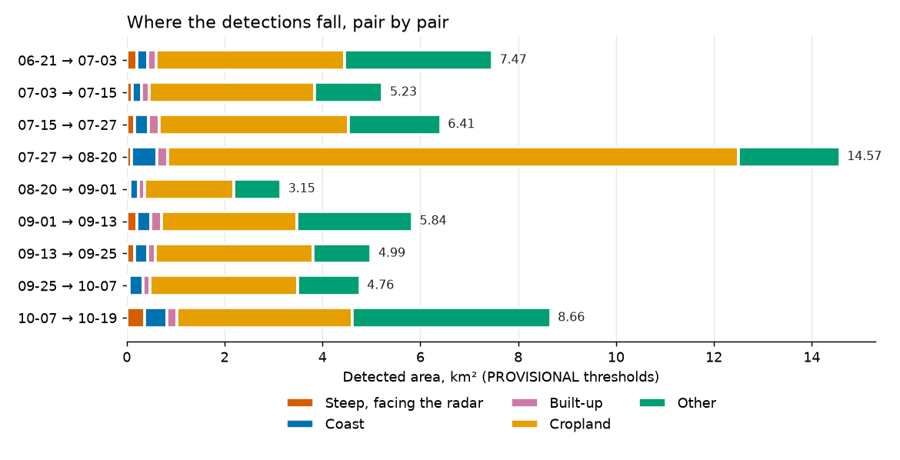
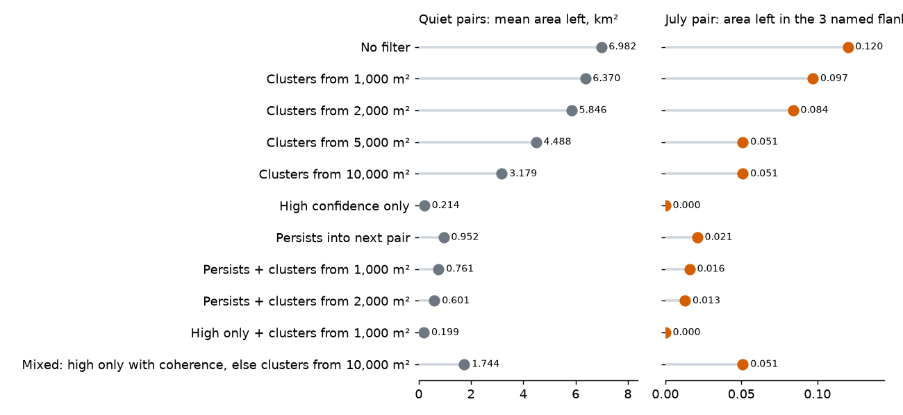
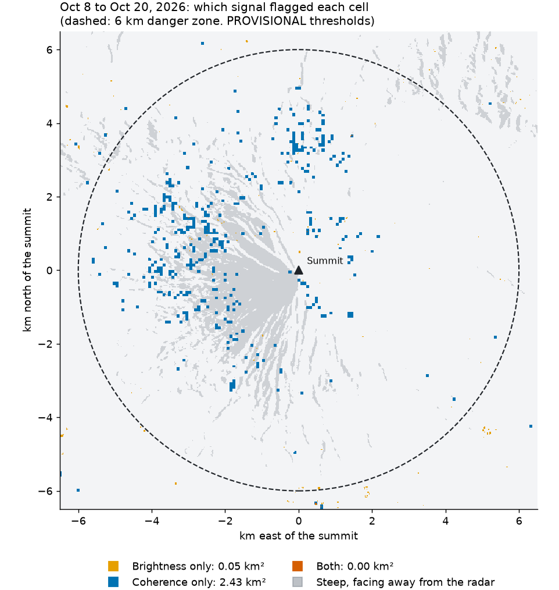

# Threshold study, night 1 (T-016, analysis only)

**No thresholds were chosen.** The final values are the owner's decision. The site config still holds the PROVISIONAL values (3.0 dB, coherence loss 0.3). No product acquired on or after 2026-10-30 was searched for or opened.

Reproduce with `python pipeline/reports/threshold_study_night_1.py`. All numbers are in `threshold-study-night-1.json`.

## What the evidence says

1. **Over the whole site, the two signals don't separate the July event from quiet pairs at any candidate.** Total flagged area is similar in both groups, so most of what gets flagged is background change, not new material. A later check on the named gullies does show a signal (see the night 2 section).
2. **Brightness change gives a modest area signal.** At 3 and 4 dB, all three July pairs flag more land than every quiet pair (at 4 dB: 2.3–2.9 km² against 1.1–1.8 km²). The gap closes by 5–6 dB. The extra area is spread across the whole site, so it may be rain or farming rather than the current.
3. **Coherence loss shows no July signal.** The only July pair with a baseline (track 39) has one of the lowest coherence-loss tails of all pairs (99.9th percentile 0.29, quiet 0.24–0.48), and its high-confidence area is within the quiet range.
4. **There is one spatial hint.** In `threshold-study-maps.png`, both July pairs show a narrow linear streak near the middle of the map, on the volcano's slope, that the two quiet pairs mapped do not show. It could be a channel-confined deposit. This was seen by eye only, on 2 July and 2 quiet maps, and hasn't been compared with a source.

## Added on night 2: brightness change on the named gullies

Later checks changed point 2 above. Whole-site totals hide a clearer signal on the flanks where PHIVOLCS reported lava flows. This table is land flagged by brightness change alone at 3.0 dB, in a 60-degree wedge of each flank out to the reported flow length (km²):

| Track | Group | Basud (E) | Bonga (SE) | Mi-isi (S) |
| --- | --- | --- | --- | --- |
| 111 | 5 quiet pairs | 0.002–0.006 | 0.002–0.009 | 0–0.007 |
| 111 | **Spans the event** | **0.011** | **0.040** | **0.061** |
| 39 | 2 quiet pairs | 0.056–0.077 | 0.026–0.055 | 0.001–0.003 |
| 39 | **Spans the event** | **0.114** | **0.099** | **0.098** |
| 104 | 1 quiet pair | 0.007 | 0.004 | 0.002 |
| 104 | **Spans the event** | **0.027** | **0.019** | **0.068** |

On every track and flank, the July pair is above the quiet pairs. Mi-isi stands out most. Adding coherence loss raises the quiet pairs' numbers more than the July pairs', which is why a first comparison hid this.

Limits: these are small areas, the wedges are coarse and overlap, only 8 quiet pairs were used, and the rule was chosen after a first attempt gave a misleading result. It measures change on a flank, not a deposit in a gully. Only 3.0 dB was tested. See `july-gully-check.json`.

**For the owner's decision:** this suggests brightness may carry more of the signal than coherence loss on these slopes, at least for this event. It doesn't choose values.

## Pairs studied

| Pair | Group | Coherence loss? |
| --- | --- | --- |
| A111F008 08-20 → 09-01 | Quiet | Yes |
| A111F008 09-13 → 09-25 | Quiet | Yes |
| A111F008 09-25 → 10-07 | Quiet | Yes |
| A111F008 10-07 → 10-19 | Quiet | Yes |
| A039F008 09-08 → 09-20 | Quiet | Yes |
| A039F008 09-20 → 10-02 | Quiet | Yes |
| D104F082 09-13 → 09-25 | Quiet | Yes |
| A111F008 07-03 → 07-15 | Spans 07-14 | **No: previous pair has no GUNW on ASF** |
| A039F008 07-10 → 07-22 | Spans 07-14 | Yes |
| D104F082 07-03 → 07-15 | Spans 07-14 | **No: previous pair has no GUNW on ASF** |

The plan asked for the track 111 July pair. Because it has no baseline, the track 39 and track 104 July pairs were added.

## Percentiles on land

Absolute brightness change (dB):

| Pair | P50 | P90 | P95 | P99 | P99.9 |
| --- | --- | --- | --- | --- | --- |
| A111 08-20 → 09-01 | 0.54 | 1.38 | 1.70 | 2.54 | 4.70 |
| A111 09-13 → 09-25 | 0.48 | 1.24 | 1.53 | 2.39 | 4.77 |
| A111 09-25 → 10-07 | 0.48 | 1.24 | 1.54 | 2.43 | 4.74 |
| A111 10-07 → 10-19 | 0.50 | 1.29 | 1.60 | 2.45 | 4.67 |
| A039 09-08 → 09-20 | 0.55 | 1.43 | 1.78 | 2.70 | 4.60 |
| A039 09-20 → 10-02 | 0.58 | 1.50 | 1.86 | 2.84 | 5.02 |
| D104 09-13 → 09-25 | 0.49 | 1.29 | 1.61 | 2.57 | 5.14 |
| **A111 07-03 → 07-15** | 0.56 | 1.45 | 1.79 | 2.86 | 5.95 |
| **A039 07-10 → 07-22** | 0.58 | 1.52 | 1.91 | 3.23 | 6.10 |
| **D104 07-03 → 07-15** | 0.58 | 1.53 | 1.91 | 3.12 | 5.92 |

Coherence loss:

| Pair | P50 | P90 | P95 | P99 | P99.9 |
| --- | --- | --- | --- | --- | --- |
| A111 08-20 → 09-01 | −0.112 | 0.002 | 0.039 | 0.118 | 0.236 |
| A111 09-13 → 09-25 | −0.075 | 0.046 | 0.086 | 0.204 | 0.467 |
| A111 09-25 → 10-07 | −0.027 | 0.079 | 0.118 | 0.223 | 0.414 |
| A111 10-07 → 10-19 | 0.040 | 0.162 | 0.207 | 0.301 | 0.467 |
| A039 09-08 → 09-20 | −0.012 | 0.092 | 0.125 | 0.207 | 0.393 |
| A039 09-20 → 10-02 | −0.038 | 0.077 | 0.118 | 0.245 | 0.482 |
| D104 09-13 → 09-25 | −0.174 | −0.022 | 0.017 | 0.116 | 0.410 |
| **A039 07-10 → 07-22** | −0.066 | 0.045 | 0.082 | 0.165 | 0.291 |

The medians differ by pair (−0.17 to +0.04), so overall coherence shifts between dates. A fixed threshold therefore flags more on some dates than on others: at loss 0.2, A111 10-07 → 10-19 flags 35 km², of which 16 km² is inside the danger zone.

## Candidates

Three candidates for the owner to weigh. Area is km² of land flagged, as high + low. July pairs on tracks 111 and 104 can only be low confidence. For quiet pairs, all of it counts as flagged by mistake, assuming they really are quiet.

| Candidate | Quiet pairs, total | Quiet pairs, high only | A039 July, total (high) | A111 July, total | D104 July, total |
| --- | --- | --- | --- | --- | --- |
| A: 3.0 dB, 0.3 (the PROVISIONAL values) | 3.24–8.60 | 0.06–0.76 | 7.06 (0.12) | 5.20 | 6.83 |
| B: 4.0 dB, 0.4 | 1.10–2.53 | 0.02–0.24 | 2.85 (0.05) | 2.29 | 2.74 |
| C: 5.0 dB, 0.5 | 0.41–0.98 | 0.01–0.05 | 1.29 (0.02) | 1.15 | 1.22 |

Trade-offs:

- **A** catches the most but looks noisy: the reference pair, with no recorded event, shows 8.60 km² of "new material" on the map.
- **B** has about a third of A's false area. Its July totals (2.29–2.85) overlap the top of the quiet range (up to 2.53).
- **C** flags the least, but so little that a small deposit could be missed. The July pairs are only slightly above the quiet range.

Inside the danger zone, flagged area doesn't rise in July at any candidate. At candidate A, the quiet range is 0.06–2.49 km², and the July pairs have 0.20–0.49 km².

The full grid (brightness 2–6 dB by loss 0.2–0.5) is in the JSON.

## Figures

- `threshold-study-brightness-hist.png`: absolute brightness change, all pairs.
- `threshold-study-coherence-hist.png`: coherence loss, the 8 pairs with a baseline.
- `threshold-study-flagged-area.png`: land flagged by each brightness threshold, with loss at 0.5.
- `threshold-study-maps.png`: where the PROVISIONAL values flag land, 2 July and 2 quiet pairs.

## Limits of this study

- **"Quiet" only means no recorded event.** Reports describe an active lava flow in July, so activity may run through other pairs too. June to October is also the rainy season, and rain and farming both change radar brightness. Weather was not checked.
- **The location of the July deposit is unknown here.** Without it, detection can't be measured directly, only total area. A validation against named gullies would give a better test (T-035).
- **The baseline may hide the event.** Coherence loss compares with the previous pair. If the slope was already changing, its coherence was already low.
- **The event date needs checking.** The Asia News Network article appears to place the current on a Monday, and 2026-07-14 is a Tuesday. Either date falls in the same pairs.
- **One quiet baseline spans 24 days.** A111 08-20 → 09-01 uses 07-27 → 08-20 as its baseline, because no pass was found for 08-08. A longer gap lowers coherence, which may be why its median loss is so negative (−0.112). This pair's coherence numbers here are from before the pipeline stopped comparing unequal gaps (night 2), so its published record now has brightness only.
- **The July coherence result rests on one pair.** Track 39 is the only July pair with a baseline, so this evidence is thin.
- **Thresholds were tested on a 5 × 5 filtered 10 m grid.** Single pixels and small specks count fully. There is no minimum patch size, because the docs don't call for one.

## Added on day 3: false-alarm study

**No filter was turned on, and no default or threshold changed.** All filters stay off in `pipeline/sites/mayon.json`; choosing is the owner's decision. Every number uses the PROVISIONAL thresholds and the 9 published pairs, all from before 2026-10-30. To reproduce: `python pipeline/reports/false_alarm_study.py`. Full numbers are in `false-alarm-study.json`.

### What it found

1. **Most detections are on cropland.** Cropland is 7.7% of the land but holds 41–80% of the detected area in every pair. So the map is largely showing farming, and possibly wet or dry fields.
2. **No filter separates the July event from quiet pairs by itself.** Each one removes real signal along with the false alarms. "High confidence only" removes July completely, because that pair has no coherence data.
3. **The upper northwest slopes stand out in one pair only.** See "One pair to check" below. I wouldn't call that pair a false alarm yet.

### Where detections fall (km²)

Each cell gets one place, first match wins: steep and facing the radar, within 500 m of the sea, built-up, cropland, then other.

| Pair (UTC dates) | Coherence | Total | Steep, facing radar | Coast | Built-up | Cropland | Other | In danger zone* | NW of summit, in zone* |
| --- | --- | --- | --- | --- | --- | --- | --- | --- | --- |
| 06-21 → 07-03 | No | 7.47 | 0.21 | 0.22 | 0.17 | 3.86 | 3.01 | 0.32 | 0.04 |
| **07-03 → 07-15 (July event)** | No | 5.23 | 0.12 | 0.19 | 0.15 | 3.39 | 1.38 | 0.21 | 0.06 |
| 07-15 → 07-27 | Yes | 6.41 | 0.16 | 0.28 | 0.23 | 3.86 | 1.89 | 0.60 | 0.09 |
| 07-27 → 08-20 (24 days) | No | 14.57 | 0.10 | 0.52 | 0.22 | 11.67 | 2.06 | 0.14 | 0.06 |
| 08-20 → 09-01 | No | 3.15 | 0.07 | 0.17 | 0.13 | 1.83 | 0.95 | 0.07 | 0.02 |
| 09-01 → 09-13 | Yes | 5.84 | 0.20 | 0.29 | 0.22 | 2.76 | 2.36 | 0.22 | 0.04 |
| 09-13 → 09-25 | Yes | 4.99 | 0.15 | 0.28 | 0.15 | 3.22 | 1.19 | 0.25 | 0.02 |
| 09-25 → 10-07 | Yes | 4.76 | 0.05 | 0.28 | 0.15 | 3.02 | 1.26 | 0.06 | 0.01 |
| **10-07 → 10-19** | Yes | 8.66 | 0.37 | 0.45 | 0.20 | 3.58 | 4.05 | **2.49** | **1.20** |
| Share of all land | | | 5.1% | 3.2% | 3.1% | 7.7% | 80.9% | | |

\* These two columns overlap the place columns.

Totals here run up to 0.08 km² above the published ones, because this study measures cells on the 20 m web grid and the pipeline measures them on the radar's own grid. The app shows these same two pairs in Philippine dates: 09-25 → 10-07 is Sep 26 → Oct 8, and 10-07 → 10-19 is Oct 8 → Oct 20.

### What each filter does

"Removed" compares the mean total on the 8 quiet pairs with no filter. The flank columns use the same three wedges as the night 2 check (Basud, Bonga and Mi-isi).

| Filter | Quiet mean (km²) | Removed | Quiet worst (km²) | July total (km²) | July, in the flanks (km²) | Quiet worst, in the flanks (km²) |
| --- | --- | --- | --- | --- | --- | --- |
| No filter | 6.98 | | 14.57 | 5.23 | 0.120 | 0.375 |
| Clusters from 1,000 m² | 6.37 | 9% | 13.83 | 4.48 | 0.097 | 0.356 |
| Clusters from 2,000 m² | 5.85 | 16% | 13.13 | 3.83 | 0.084 | 0.335 |
| Clusters from 5,000 m² | 4.49 | 36% | 11.16 | 2.32 | 0.051 | 0.322 |
| Clusters from 10,000 m² | 3.18 | 54% | 9.71 | 1.53 | 0.051 | 0.279 |
| High confidence only | 0.21 | 97% | 0.58 | **0.00** | **0.000** | 0.003 |
| Persists into next pair | 0.95 | 86% | 2.34 | 0.94 | 0.021 | 0.019 |
| Persists + clusters from 1,000 m² | 0.76 | 89% | 2.06 | 0.71 | 0.016 | 0.016 |
| Persists + clusters from 2,000 m² | 0.60 | 91% | 1.80 | 0.51 | 0.013 | 0.013 |
| High only + clusters from 1,000 m² | 0.20 | 97% | 0.55 | **0.00** | **0.000** | 0.002 |
| Mixed: high only with coherence, else clusters from 10,000 m² | 1.74 | 75% | 9.71 | 1.53 | 0.051 | 0.035 |

Persistence is counted on 7 quiet pairs, because the latest pair has no next pair yet. The mixed row applies different rules to different pairs, so its flank comparison isn't like for like.

### Recommended combinations, for the owner to choose from

None of these makes the map ready to present as detection on its own.

| Option | Why | What it costs | Config |
| --- | --- | --- | --- |
| **1. Light clean-up: clusters from 2,000 m²** | Keeps most of the July flank signal (70%), so it's the safest | Only removes 16%, so the map still looks busy | `min_cluster_m2: 2000` |
| **2. Stronger clean-up: clusters from 10,000 m²** | Removes 54%. It keeps the same July flank area as 5,000 m² while removing more | Loses 58% of the July flank signal, and the worst quiet pair still shows 9.71 km² | `min_cluster_m2: 10000` |
| **3. Mixed: high confidence where coherence exists, else clusters from 10,000 m²** | Removes the most (75%) while keeping some July signal, and the only row where July clearly beats the quiet pairs in the flanks | **Needs a small code change.** Rests on one event, and the high-only half is untested on a real event because the July pair has no coherence | Not expressible yet |

**Not recommended: persistence.** It needs the next pass, so results would arrive at least 12 days late. A deposit that appears once and then stays the same should change in one pair only, so this filter tends to remove what the app is looking for. That fits the result: it keeps only 18% of the July flank signal. For that reason it's available to this study, and a normal pipeline run stops with a clear message if it's turned on.

**An idea outside the brief:** hiding or dimming cropland would remove 41–80% of the area at once, more than any cluster filter. It wasn't tested as a filter, because new material can reach fields too, and a land-cover map from 2021 won't show recent changes.

### One pair to check

10-07 → 10-19 has 2.49 km² inside the danger zone, about 4 to 40 times the other pairs, and 1.20 km² of that is northwest of the summit. Those northwest slopes face away from the radar. This is the last pair before the 2026-10-30 eruption.

It might be a false alarm, for example from weather. It might also be real change on the volcano before the eruption. **This study can't tell which**, so calling it quiet is an assumption. Check it against PHIVOLCS bulletins for October before tuning anything to remove it.

### Limits

- **One event.** All the July evidence comes from one pair, with brightness only, and the wedges are coarse flank shapes, not channels.
- **Quiet is assumed.** Quiet pairs may hold real change. 07-15 → 07-27 has the highest flank total (0.375 km²), right after the event, and it can flag on coherence alone, which the July pair can't. So flank comparisons between pairs with and without coherence aren't like for like. The night 2 section compares them fairly, using brightness only.
- **Land cover is from 2021**, at 10 m, and is read here at 20 m. Coconut groves count as tree cover, so some farming is in "other". WorldCover is context only, and isn't drawn on the map.
- **Steep slopes:** 20° or more, from a 30 m elevation model, within 60° of the direction to the radar (77°). The product metadata says `lookDirection: Left` and `Ascending`, which gives that direction. The published images don't confirm it: average brightness barely changes with slope direction, probably because the product corrects for terrain.
- **Sources** are cited in `site/data/sources.json` as `validation`, the closest value `docs/05` allows, since it has none for analysis.

## Added in the afternoon run: Oct 8 → Oct 20, and masks

**No mask was turned on, and no default or threshold changed.** All numbers use the PROVISIONAL thresholds and pairs from before 2026-10-30. To reproduce: `python pipeline/reports/reach_zone_study.py`, which downloaded no radar data. Full numbers are in `reach-zone-study.json`.

### Oct 8 → Oct 20 inside the danger zone

| Signal | Area (km²) | Share | NW of summit (km²) | On steep slopes facing away (km²) | Near-grazing beam (km²) | Near the noise floor (km²) |
| --- | --- | --- | --- | --- | --- | --- |
| Coherence only | 2.433 | 98% | 1.180 | 0.447 | 0.057 | 0.000 |
| Brightness only | 0.054 | 2% | 0.021 | 0.019 | 0.016 | 0.000 |
| Both | 0.004 | 0.2% | 0.002 | 0.000 | 0.000 | 0.000 |

**What this says:**

1. **Almost all of it is coherence only.** Brightness barely changed there, and only 0.004 km² has both signals, so the app rates nearly all of it low confidence.
2. **Radar geometry doesn't explain it.** Steep away-facing slopes are 10% of the zone's land and hold 18% of the coherence-only area, so they're only mildly over-represented. The other 82% is elsewhere.
3. **Radar noise doesn't explain it.** None of it is at or below -18 dB. The check does work: faint land exists there, with values down to -25 dB, and the zone's median is about -6 dB.
4. **It's unusual.** Other pairs with coherence in use have 0.02–0.37 km² of coherence-only area in the zone. This pair has 7 to 120 times that.

**What it doesn't say:** whether this is real. Coherence falling with no brightness change could be wet ground or changing vegetation, and could also be thin disturbance of the surface. A thick fresh deposit would usually be expected to change brightness as well, which leans against one, but that's general reasoning and isn't tested here. Rain records for Oct 8–20, PHIVOLCS bulletins, and a pass from another track over the same dates would each help.

The blocky look comes from coherence's coarser grid, about 80 m against 20 m.

**How the terms are defined:**

- **Facing away:** a slope of 20° or more, within 60° of directly away from the radar. The pass direction and left-looking radar come from the product's metadata.
- **Near-grazing:** the beam is 70° or more from the ground's perpendicular. This uses an **assumed** 40° beam angle, not one read from the product. At that angle, true shadow is only about 0.009 km² of the zone.
- **Noise floor:** the fainter pass at or below a test level. The real noise level wasn't read from the product, so -25, -22, -20 and -18 dB were all tried, and all gave 0. The mask below uses -20 dB.

### Masks on every pre-eruption pair

The quiet set is 7 pairs. It leaves out the July pair and Oct 8 → Oct 20, so its base differs from the day 3 table, which counted October as quiet. The mask comes first, then clusters.

| Option | Quiet mean (km²) | Quiet removed | Quiet worst (km²) | Cropland share of quiet | July total (km²) | July flanks (km²) | July flanks kept | Oct 8 → Oct 20 (km²) | October kept |
| --- | --- | --- | --- | --- | --- | --- | --- | --- | --- |
| No mask | 6.74 | | 14.57 | 66% | 5.23 | 0.120 | 100% | 8.66 | 100% |
| Clusters from 2,000 m² only | 5.56 | 17% | 13.13 | 72% | 3.83 | 0.083 | 69% | 7.83 | 90% |
| Within 8 km | 0.57 | 92% | 1.05 | 6% | 0.57 | 0.120 | 100% | 2.83 | 33% |
| Within 8 km + clusters | 0.41 | 94% | 0.85 | 7% | 0.32 | 0.083 | 69% | 2.73 | 32% |
| Within 10 km | 2.01 | 70% | 4.02 | 48% | 1.77 | 0.120 | 100% | 4.03 | 47% |
| Within 10 km + clusters | 1.53 | 77% | 3.32 | 52% | 1.14 | 0.083 | 69% | 3.76 | 43% |
| Within 12 km | 3.99 | 41% | 8.61 | 61% | 3.52 | 0.120 | 100% | 5.62 | 65% |
| Within 12 km + clusters | 3.19 | 53% | 7.51 | 67% | 2.54 | 0.083 | 69% | 5.12 | 59% |
| Noise floor and away-facing slopes | 6.62 | 2% | 14.46 | 67% | 5.10 | 0.113 | 94% | 8.07 | 93% |
| Noise and away-facing + clusters | 5.49 | 19% | 13.07 | 72% | 3.75 | 0.077 | 64% | 7.26 | 84% |

**What this says:**

- **A reach zone removes far more than any filter tried so far**, mainly because it removes farmland: at 8 km, cropland falls from 66% to 6% of quiet area.
- **"100% of July flanks kept" is partly built in.** The flank wedges only reach 3.8 km, so a mask at 8 km or more can't touch them. It shows the mask is safe for those three flanks, not that the mask finds the event better. The July pair's flanks (0.120 km²) are still below the worst quiet pair's (0.374 km²), with or without a reach mask.
- **A reach zone hides things as well as cleaning up.** It would blank anything beyond its edge, and the reason to watch further out is flows travelling down channels toward towns. Town label points are about 8.6 km (Daraga), 8.8 km (Camalig), 8.9 km (Legazpi City), 9.5 km (Ligao City), 10.0 km (Bacacay) and 10.3 km (Guinobatan) from the summit. So 8 km cuts off every one of these, and 10 km still cuts off Guinobatan.
- **The noise and away-facing mask isn't worth having.** It removes 2% and costs 6% of the July flank signal.

### Options for the owner

| Option | For | Against |
| --- | --- | --- |
| **Within 12 km alone** | Keeps these town centres and every July flank cell, and removes 41% | Quiet pairs still average 3.99 km² |
| **Within 10 km alone** | Removes 70% with no loss in the flanks. My pick if you want a mask now, because the map stops looking like a farmland map | Cuts off Guinobatan's label point. The map must say that it only looks within 10 km |
| **Within 10 km + clusters from 2,000 m²** | Removes 77% | Loses 31% of the July flank signal for 7 more points |

None of these tells real change from false alarms inside the zone. They limit where the map looks.

## Note on rerunning these studies

**Published grids changed after this study.** Mayon now uses the 10 km reach, so `false_alarm_study.py` and `reach_zone_study.py` read masked grids if rerun today. Their numbers above came from the grids before the mask. To reproduce them, check out commit 5768d19.
